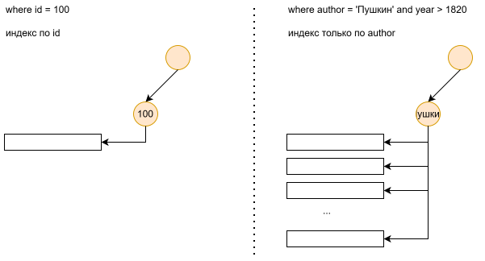

# Что такое индекс

- `Индекс` - это специальная структура данных для ускорения поиска в таблице

  - Как именно индекс хранится, как он реализован - это технические детали конкретных СУБД

- Для построения индексов существует несколько разных алгоритмов

  - Они отличаются в разных СУБД, но есть и общие
    - Например, `B-tree` индекс (сбалансированное дерево) есть во всех СУБД
  - Разные виды индексов достигают ускорения поиска за счет разных принципов
    - Но ключевое то, что цель индекса - ускорение поиска, а как - это детали реализации

  

# Недостатки индексов

* Индексы замедляют модификацию данных (вставку, обновление, удаление)
  * Потому что приходится пересчитать индексы с учетом измененных данных
* Индексы тоже занимают определенный объем хранилища

Тем не менее, польза от правильно составленных индексов перевешивает эти накладные расходы.


# Эффективность индекса

- Индекс наиболее эффективен, когда позволяет отбросить много данных и неэффективен, если отбрасывает мало
  - В последнем случае планировщик может посчитать последовательный перебор более эффективным, и не будет использовать индекс
- Поэтому индексы надо строить по полю \ полям в высокой `селективностью`


## Селективность и кардинальность

- `Кардинальность` - это количество уникальных значений в столбце
  - Например, в поле пол может быть только "М" и "Ж" - кардинальность всегда равна 2. А в поле телефон - смотря сколько уникальных телефонов. Теоретически, все телефоны уникальны, значит кардинальность потенциально равна N (столько же, сколько строк в таблице). 
  - У primary key кардинальность всегда равна N.
- `Селективность` - это мера уникальности значений в столбце / комбинации столбцов
  - Много уникальных значений - высокая селективность - хорошо
  - Мало уникальных значений - низкая селективность - плохо
- Селективность можно выразить числом, по формуле

```
кардинальность \ общее количество записей
```

- Диапазон получается от 0 до 1
  - Чем ближе к 1, тем соответственно лучше (высокая селективность)
- Например, поле "пол" кардинальность равна 2
  - На 100_000 записей селективность составит `2 \ 100_000 = 0.00002`
- Поле "автор" допустим имеет кардинальность 1000
  - Его селективность `1_000 \ 100_000 = 0.01`
- У кого значение выше, у того значит выше селективность, значит это поле лучше подходит для индекса
  - `"автор" (0.01) > "пол" (0.00002)`, поэтому "автор" лучше подходит для индекса
- Иногда результат умножают на 100%, чтобы получить результат в процентах
- id - идеальная селективность (1), абсолютно уникальные значения
  - поэтому по id все СУБД обычно сами автоматически делают индекс


## Почему низкая селективность - плохо для индекса

- Поиск данных связан с чтением с диска
- Технически чтение бывает последовательным и произвольным
  - Последовательное чтение - это когда блоки диска читаются друг за другом
  - Произвольное чтение - это когда блоки читаются то из одного места диска, то из другого ("прыжки")
  - Технически последовательное чтение быстрее
- Поиск в индексе - это произвольное чтение
  - Причем произвольное чтение два раза - первый раз при поиске в самом индексе, второй раз - для выбора данных из таблицы
- Поиск в таблице - это последовательное чтение
- Как эти факторы связаны с селективностью?


### Пример "Ищем мужчин"

- Допустим, в таблице сотрудников 100 000 записей. Мы сделали индекс по полю "пол" (низкая селективность). Выбираем всех мужчин, находим 30 000 записей в индексе. Теперь надо сделать 30 000 прыжков, чтобы прочитать данные из таблицы об этих найденных мужчинах.
- Поскольку технически прыжки гораздо дороже последовательного чтения, то выйдет, что прочитать 100 000 записей последовательно для поиска мужчин будет технически выгоднее, чем использовать индекс и прыгать 30 000 раз.
- Поэтому планировщик не будет использовать такие невыгодные индексы. Поэтому и создавать их бесполезно.


### Пример "Популярный автор"

- Допустим, в таблице постов 10 000 и 9000 из них написал один автор - Вася, а остальная 1000 размазана еще по десятку других авторов
- Мы сделали индекс по автору
  - Потенциально селективность хорошая
  - Но на практике, если мы захотим найти посты Васи по индексу, то обнаружим 9000 записей, значит надо сделать 9000 прыжков к таблице
  - Поэтому технически выгоднее последовательно просмотреть 10000 записей, чем использовать индекс
  - Но если мы захотим найти посты Пети, который  написал их всего 2 штуки, то очевидно выгоднее сделать 2 прыжка, чем последовательно читать все 10000
- Из этого примера надо уяснить, что индекс по полю, которое потенциально дает хорошую селективность, может в конкретном случае быть невыгодным из-за состояния данных в текущий момент
  - Хорошая новость в том, что планировщики сами понимают в таком случае, что выгоднее - искать по индексу или последовательно
    - Они хранят свою внутреннюю статистику по значениям, но это технические детали
  - Поэтому мы просто создаем индекс, который имеет хороший потенциал, а планировщик сам решает в моменте, использовать его или нет


# Технические разновидности индексов

- Индексы реализуются на разных принципах и алгоритмах
  - Это делает какие-то индексы более эффективными для каких-то конкретных задач и менее эффективными для других
- Примеры индексов
  - B-tree
  - TODO остальные


# B-tree индексы

## Что такое B-tree

- `B-tree` индекс (сбалансированное дерево) есть во всех СУБД.
  - Сбалансированное дерево - это дерево, где у каждого узла высота левого и правого поддерева отличается не более чем на 1.
  - B-tree используется по умолчанию и годится для большинства повседневных задач.
  - Хорошо работает на данных, для которых работает оператор сравнения.


## Узлы и листья

- В узлах дерева хранятся ключи - значение поля / полей, по которым построен индекс, и ссылки на дочерние узлы.
- В листьях дерева - хранится либо ссылка на данные, либо сами данные.
  - (в зависимости от того, какой индекс - кластеризованный или нет)
- Узлы в БД это не узлы из учебника, где в каждом узле одно значение.
  - В БД в узлах хранится много ключей в отсортированном виде. Узел - это целая страница. За счет того что в узлах не хранятся данные, можно напихать в них больше ключей и тем самым сделать высоту дерева меньше. Следовательно, искать быстрее, потому что меньше приходится читать индексных узлов из памяти.
    - Поэтому данные всегда хранятся только в листьях, а в узлах - не хранятся.
- P.P.S. Листья - это "конечные" узлы если что (у которых нет потомков).


## Почему поиск быстрый

- Поскольку дерево - упорядоченная структура, то можно быстро отбросить часть данных и получить т.о. ускорение поиска
  - Можно либо сразу найти конкретное значение
    - Например `id = 100`
  - Либо проводить последовательный поиск на небольшой части данных
    - Например `author = 'Пушкин' and year > 1820`
      - Для случая, когда индекс только по полю author - СУБД быстро находит все книги Пушкина и начинает среди них уже последовательно перебирать в поисках тех что написаны после 1820 года
  - P.S. Как поиск в b-деревьях работает - это отдельная тема, т.к. это не просто двоичное дерево, тут поиск комбинированный




## Кластеризованный и некластеризованный индекс

- Такое деление характерно для b-tree индексов
- Главное отличие - в том что хранится в листьях
  - `Кластеризованный` индекс - в листьях хранятся сами данные
    - В этом случае индекс и есть сама "таблица" с данными. Поэтому кластеризованный индекс может быть только один.
  - `Некластеризованный` - в листьях хранятся ссылки на данные.
    - Поэтому некластеризованных индексов может быть сколько угодно. В листьях хранится значение индексированного поля / полей + ссылка на строку таблицы.
- Несколько мыслей
  - Кластеризованные индексы имеет смысл создавать на поля, значения в которых идут нарастающим манером
    - Например "дата добавления поста"
      - Потому что это не приводит к сильной перестройке индекса, т.к. строка добавляется в конец
        - Если же сделать, например, на поле "фамилия", то новую строку с фамилией "Петров" придется вставлять куда-то в середину данных, и все окружающие данные придется перекладывать, что очевидно дороже чем добавлять в конец


# Тактики использования индексов

## Несколько индексов для таблицы

- Для одной таблицы можно строить несколько индексов для ускорения разных запросов
- Какое поле \ набор полей выбрать для индекса - зависит от того, какие поля фигурируют чаще всего в запросах в предложениях where и order by. 


## Составной индекс

- `Составной индекс` - это индекс, который строится по нескольким полям.
  - Разумное количество полей 2-3.
    - Технически можно гораздо больше, но фактически это приводит к деградации скорости.
  - Порядок полей важен.
    - Сортировка идет именно в том порядке, какой указан в индексе.
  - Обычно составной индекс используется для b-tree индексов.
- Например, делаем индекс по полю country + city и получаем ускорение запросов вида:

```sql
SELECT population, postal_code 
FROM cities 
WHERE country = 'Russia' AND city = 'Moscow';
```

```sql
SELECT city
FROM cities 
WHERE country = 'Russia'
```

- А вот такой запрос не ускорится

```sql
SELECT population, postal_code 
FROM cities 
WHERE city = 'Moscow';
```

- Потому что сортировки непосредственно по city нет
  - Сортировка по city только в пределах country, потому что индекс на country + city
  - Так что для ускорения такого запроса надо делать отдельный индекс только по city


## Покрывающий индекс

- `Покрывающий индекс` - это скорее паттерн использования индексов, а не отдельный технический тип
  - Это индекс, в котором есть все данные, необходимые для запроса. Поэтому при нахождении узла нет нужды прыгать в таблицу за данными.
- Покрывающий индекс в разных СУБД можно сделать по-разному
  - Например, в postgres можно создать индекс и через include дополнительно включить в него нужные для запроса данные. При этом эти данные не будут участвовать в сортировке.
  - А например в oracle нет такой "include"-возможности и придется включить все нужные поля в состав самого индекса, что сделает его тяжелее, потому что они будут участвовать в сортировке.
- Пример покрывающего индекса
  - Например, "получить все заказы клиента, начиная с недавних", вполне обычная задача для личного кабинета интернет-магазина
    - Делаем составной индекс по user_id + created_at + order_id

```sql
SELECT order_id
FROM orders 
WHERE user_id = 123 
ORDER BY created_at DESC
LIMIT 20
```

- Движку не надо обращаться к таблице, чтобы получить order_id, потому он есть в индексе
- P.S. Был вопрос - а не лучше ли сделать индекс по created_at DESC, раз нам всегда нужны данные в обратном порядке?
  - Ответ - нет, не лучше. Движок нормально читает индекс задом наперед, поэтому даже ASC индекс хорошо работает при DESC-выборке.


## Частичный индекс

- TODO

# TODO

В индекс включаются поля, которые наиболее часто фигурируют в запросах в предложениях where и order by, а при выборе последовательности полей в индексе можно ориентироваться на селективность (это я правда уже сам такой вывод сделал, а не прочитал где-то, так что инфа не 100%).

- Способ хранения данных
  - Неупорядоченная таблица - что значит?
  - Еще какие?


