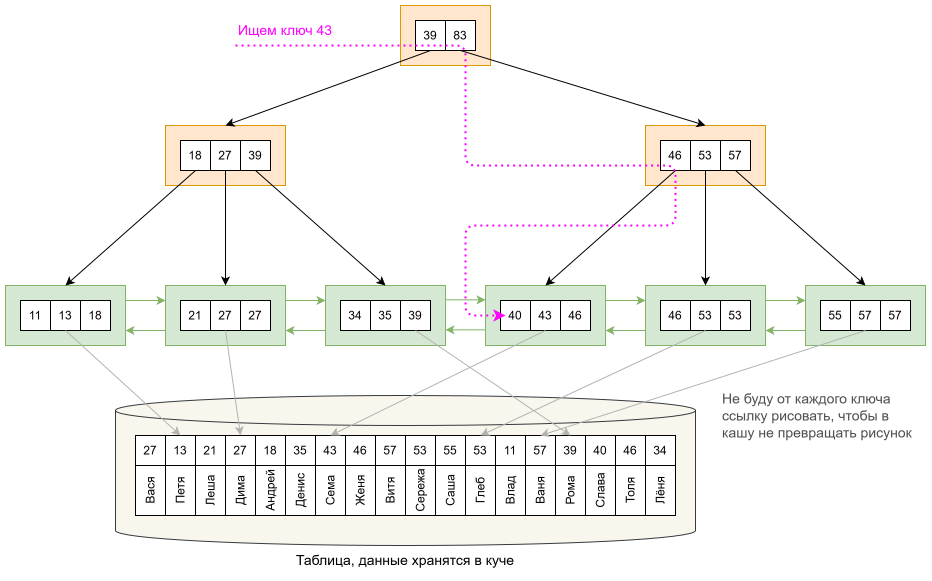

- Вот эту ссылку главное не просрать https://use-the-index-luke.com/sql/anatomy

# Что такое индекс

- `Индекс` - это специальная структура данных для ускорения поиска в таблице

  - Как именно индекс хранится, как он реализован - это технические детали конкретных СУБД

- Для построения индексов существует несколько разных алгоритмов

  - Они отличаются в разных СУБД, но есть и общие
    - Например, `B-tree` индекс (сбалансированное дерево) есть во всех СУБД
  - Разные виды индексов достигают ускорения поиска за счет разных принципов
    - Но ключевое то, что цель индекса - ускорение поиска, а как - это детали реализации.

  

# Недостатки индексов

* Индексы замедляют модификацию данных (вставку, обновление, удаление)
  * Потому что приходится пересчитать индексы с учетом измененных данных
* Индексы тоже занимают определенный объем хранилища
  * Если индексы, созданные для таблицы, суммарно начинают занимать больше места, чем сама таблица - это плохой звонок. Скорее всего тут либо созданы лишние индексы, либо индексы созданы неэффективно, либо вообще нужна не реляционная СУБД для задачи.

Тем не менее, польза от правильно составленных индексов перевешивает эти накладные расходы.


# Эффективность индекса

- Индекс наиболее эффективен, когда позволяет отбросить много данных и неэффективен, если отбрасывает мало
  - В последнем случае планировщик может посчитать последовательный перебор более эффективным, и не будет использовать индекс
- Поэтому индексы хорошо работают на полях с высокой `селективностью`
- Все запросы надо выполнять с `explain analyze` чтобы видеть план выполнения и понимать, как БД ищет данные, использует ли индексы и т.д.


## Селективность и кардинальность

- :question: Что такое селективность и кардинальность?
- `Кардинальность` - это количество уникальных значений в столбце
  - Например, в поле пол может быть только "М" и "Ж" - кардинальность всегда равна 2. А в поле телефон - смотря сколько уникальных телефонов. Теоретически, все телефоны уникальны, значит кардинальность потенциально равна N (столько же, сколько строк в таблице). 
  - У primary key кардинальность всегда равна N.
- `Селективность` - это мера уникальности значений в столбце / комбинации столбцов
  - Много уникальных значений - высокая селективность - хорошо
  - Мало уникальных значений - низкая селективность - плохо
- Селективность можно выразить числом, по формуле

```
кардинальность \ общее количество записей
```

- Диапазон получается от 0 до 1
  - Чем ближе к 1, тем соответственно лучше (высокая селективность)
- Например, поле "пол" кардинальность равна 2
  - На 100_000 записей селективность составит `2 \ 100_000 = 0.00002`
- Поле "автор" допустим имеет кардинальность 1000
  - Его селективность `1_000 \ 100_000 = 0.01`
- У кого значение выше, у того значит выше селективность, значит это поле лучше подходит для индекса
  - `"автор" (0.01) > "пол" (0.00002)`, поэтому "автор" лучше подходит для индекса
- Иногда результат умножают на 100%, чтобы получить результат в процентах
- id - идеальная селективность (1), абсолютно уникальные значения
  - поэтому по id все СУБД обычно сами автоматически делают индекс


## Почему низкая селективность - плохо для индекса

- Поиск данных связан с чтением с диска.
- Технически чтение бывает `последовательным` и `произвольным`.
  - Последовательное чтение - это когда блоки диска читаются друг за другом.
  - Произвольное чтение - это когда блоки читаются то из одного места диска, то из другого (`"прыжки"`).
  - Технически последовательное чтение быстрее.
- Если селективность низкая, значит по индексу невозможно найти одну конкретную строку или хотя бы сузить поиск до небольшого количества (по сравнению с общим количеством строк).
  - Значит индекс вернет много ключей, и значит чтобы получить по ним данные, придется сделать много "прыжков" к таблице. Так что по итогу может оказаться что просто перебрать строки одну за другой в таблице безо всяких индексов будет быстрее, за счет того что последовательное чтение быстрее произвольного.


### Пример "Ищем мужчин"

- Допустим, в таблице сотрудников 100 000 записей. Мы сделали индекс по полю "пол" (низкая селективность). Выбираем всех мужчин, находим 30 000 записей в индексе. Теперь надо сделать 30 000 прыжков, чтобы прочитать данные из таблицы об этих найденных мужчинах.
- Поскольку технически прыжки гораздо дороже последовательного чтения, то выйдет, что прочитать 100 000 записей последовательно для поиска мужчин будет технически выгоднее, чем использовать индекс и прыгать 30 000 раз.
- Поэтому планировщик не будет использовать такие невыгодные индексы. Поэтому и создавать их бесполезно.


### Пример "Популярный автор"

- Допустим, в таблице постов 10 000 и 9000 из них написал один автор - Вася, а остальная 1000 размазана еще по десятку других авторов
- Мы сделали индекс по автору
  - Потенциально селективность хорошая
  - Но на практике, если мы захотим найти посты Васи по индексу, то обнаружим 9000 записей, значит надо сделать 9000 прыжков к таблице
  - Поэтому технически выгоднее последовательно просмотреть 10000 записей, чем использовать индекс
  - Но если мы захотим найти посты Пети, который  написал их всего 2 штуки, то очевидно выгоднее сделать 2 прыжка, чем последовательно читать все 10000
- Из этого примера надо уяснить, что индекс по полю, которое потенциально дает хорошую селективность, может в конкретном случае быть невыгодным из-за состояния данных в текущий момент
  - Хорошая новость в том, что планировщики сами понимают в таком случае, что выгоднее - искать по индексу или последовательно
    - Они хранят свою внутреннюю статистику по значениям, но это технические детали
  - Поэтому мы просто создаем индекс, который имеет хороший потенциал, а планировщик сам решает в моменте, использовать его или нет.


# Технические разновидности индексов

- Индексы реализуются на разных принципах и алгоритмах
  - Это делает какие-то индексы более эффективными для каких-то конкретных задач и менее эффективными для других
- Примеры индексов
  - B-tree
  - TODO остальные


# B-tree индексы

## Что такое B-tree

- `B-tree` индекс (сбалансированное дерево) есть во всех СУБД.
  - Сбалансированное дерево - это дерево, где у каждого узла высота левого и правого поддерева отличается не более чем на 1.
  - B-tree используется по умолчанию и годится для большинства повседневных задач.
  - Хорошо работает на данных, для которых работает оператор сравнения.


## Организация B-tree индекса

- Главная цель индекса - обеспечить упорядоченное представление индексируемых данных.
- B-tree индекс для организации данных использует три структуры - дерево, массив и двусвязный список.
  - Каждый узел дерева - это страница размером несколько kb (около 8).
  - В каждом узле хранятся
    - **Несколько** ключей индекса в виде **отсортированного** массива. Это позволяет искать в нем с помощью бинарного поиска.
    - Ссылки на дочерние узлы.
  - Корень и промежуточные узлы нужны для навигации - чтобы быстро выйти на листовой узел, в котором находится искомый ключ.
  - Листья организованы в двусвязный список.
    - Листья связаны в такой последовательности, что по сути их массивы образуют логически единый отсортированный массив.
- Алгоритм поиска нужного ключа такой
  - По дереву быстро находим лист, в котором находится нужный ключ.
  - Бинарным поиском в массиве ключей внутри этого листа находим нужный ключ.
    - Если вдруг нужен не один ключ, а диапазон (например >), тогда просто двигаемся по массиву вверх, а за счет того что листья связаны в список, то можно легко захватить подходящие ключи из соседних листьев.



- P.S. Технически ссылки организуются по-разному. Часто на картинках их рисуют отдельно от ключей. Обычно на таких рисунках ссылки располагаются между ключами и получается например 3 ключа и 4 ссылки, т.е. +1. Но я ебаться не стал, это и понимать труднее, и рисовать. По сути это и не важно.
  - На этом рисунке ссылка от ключа `K` ведет на узел, в котором все ключи <= K.
- Высота дерева будет $\log_x(y)=h$ , где $x$ это количество ключей в узле, $y$ количество строк в таблице, а $h$ высота дерева.
  - Допустим, если в страницу влезло 100 ключей, а в таблице 1млрд строк, тогда высота будет всего 4-5.


## Основные причины медленного индекса

- Первая причина
  - Потенциальная необходимость просмотра большого количества листов для поиска всех совпадений ключей.
    - Как видно на рисунке, ключи повторяются. Например, 27, 53, 57 встречаются по два раза. Это значит, что СУБД придется просмотреть всю цепочку таких ключей. Причем не исключено, что например в третьем листе тоже могло бы быть 27, а значит СУБД пришлось бы загрузить еще одну страницу.
- Вторая причина
  - Для получения данных СУБД необходимо обратиться к таблице. Поскольку данные в таблице хранятся в разбросанном виде, то чем больше совпадений по ключам в индексе, тем больше вероятность что для поиска всех этих данных придется читать много страниц с данными. Это **произвольное** чтение и оно медленное.

Итого, поиск данных по индексу включает три шага: а) найти по дереву нужный лист б) просмотреть цепочку листов на предмет нужных ключей, если их несколько в) считать из таблицы нужные данные.

Только первый шаг стабильно быстрый из-за небольшой высоты дерева. Остальные два могут ощутимо замедлять работу индекса.


## Удаление из индекса

TODO: тут бы как-то подробнее надо разобраться, если уж вообще трогать эту тему

- Тут речь про postgres.
- При удалении строки из таблицы она помечается как невидимая, а индекс не затрагивается, т.е. ключ остается в индексе. Через какие-то промежутки времени запускается процесс vacuum, который реально удаляет строки из таблицы и из индекса.
  - Но прикол в том, что хотя ключи из индекса удаляются, индекс от этого не становится меньше по объему сжираемого места, потому что страницы остаются как и были, просто они "дырявые" или даже вообще пустые.
- Поэтому при массовых удалениях данных (а возможно и изменениях), можно индекс дропнуть и пересоздать, чтобы такого фрагментирования не было.
  - Если удаления не массовые, тогда фрагментация меньше, потому что когда в странице не хватает места для добавления ключа, то СУБД проверяет ее на наличие ключей, которые ведут на удаленные строки, и если такие есть, то может такой ключ удалить и вставить новый на ее место.
- TODO: В общем, при массовых операциях надо бы погуглить что к чему.


## Кластеризованный и некластеризованный индекс

- Такое деление характерно для b-tree индексов
- `Кластеризованный` индекс - условно можно считать, что данные интегрированы в сам индекс. Поэтому можно условно сказать, что сам индекс и есть таблица с данными.
  - Поэтому кластеризованный индекс может быть только один.
- `Некластеризованный` индекс - хранит только ссылки на данные, а сами данные лежат в таблице. 
  - Поэтому некластеризованных индексов может быть сколько угодно.
- P.S. Решил просто до такого концептуального минимализма свести определения. Все остальное удалил, потому что по ощущениям это жесткий нейробред был. Буду мониторить момент, когда человек хорошо расскажет про эти индексы, и тогда мб дополню. Так-то в принципе пофигу как они там технически организованы. Просто запомнить, что "кластеризованный = таблица" поможет понять почему он один. Ну и еще бы понять в каких кейсах этот индекс полезен и хватит пожалуй, чем с листьями ебаными возиться.


# Тактики использования индексов

## Советы по индексам

- Разработчик лучше всех должен понимать как составить хороший индекс, потому что он знает бизнес и условия запросов. А именно из условий запросов понятно, какой индекс нужен.
- Несколько индексов
  - Для одной таблицы можно строить несколько индексов для ускорения разных запросов.
  - Какое поле \ набор полей выбрать для индекса - зависит от того, какие поля фигурируют чаще всего в запросах в предложениях where и order by.
  - Чем больше индексов, тем больше накладные расходы на insert-update-delete. Поэтому один индекс предпочтительнее двух. Можно делать составной индекс, чтобы покрывать много запросов. Тогда можно получить профит как от двух индексов, а оверхед как для одного.


## Составной индекс

- `Составной индекс` - это индекс, который строится по нескольким полям.
  - Разумное количество полей 2-3.
    - Технически можно гораздо больше, но фактически это приводит к деградации скорости.
  - Порядок полей важен.
    - Сортировка идет именно в том порядке, какой указан в индексе.
  - Обычно составной индекс используется для b-tree индексов.
- Например, делаем индекс по полю country + city и получаем ускорение запросов вида:

```sql
SELECT population, postal_code 
FROM cities 
WHERE country = 'Russia' AND city = 'Moscow';
```

```sql
SELECT city
FROM cities 
WHERE country = 'Russia'
```

- А вот такой запрос не ускорится

```sql
SELECT population, postal_code 
FROM cities 
WHERE city = 'Moscow';
```

- Потому что сортировки непосредственно по city нет
  - Сортировка по city только в пределах country, потому что индекс на country + city
  - Так что для ускорения такого запроса надо делать отдельный индекс только по city


## Индексы от функций

- TODO
- Например "сколько сотрудников устроилось по годам + месяцам"? date_trunc


## Покрывающий индекс

- `Покрывающий индекс` - это скорее паттерн использования индексов, а не отдельный технический тип
  - Это индекс, в котором есть все данные, необходимые для запроса. Поэтому при нахождении узла нет нужды прыгать в таблицу за данными.
- Покрывающий индекс в разных СУБД можно сделать по-разному
  - Например, в postgres можно создать индекс и через include дополнительно включить в него нужные для запроса данные. При этом эти данные не будут участвовать в сортировке.
  - А например в oracle (возможно) нет такой "include"-возможности и придется включить все нужные поля в состав самого индекса, что сделает его тяжелее, потому что они будут участвовать в сортировке.
- Пример покрывающего индекса
  - Например, "получить все заказы клиента, начиная с недавних", вполне обычная задача для личного кабинета интернет-магазина
    - Делаем составной индекс по user_id + created_at + order_id

```sql
SELECT order_id
FROM orders 
WHERE user_id = 123 
ORDER BY created_at DESC
LIMIT 20
```

- Движку не надо обращаться к таблице, чтобы получить order_id, потому он есть в индексе
- P.S. Был вопрос - а не лучше ли сделать индекс по created_at DESC, раз нам всегда нужны данные в обратном порядке?
  - Ответ - нет, не лучше. Движок нормально читает индекс задом наперед, поэтому даже ASC индекс хорошо работает при DESC-выборке.
- Не лучше ли сделать индекс по created_at + user_id + order_id?
  - Ответ - не лучше. По user_id используется строгое равенство, оно позволяет отфильтровать сразу много строк. Поэтому строгое равенство всегда на первом месте надо ставить в индексе.


## Частичный индекс

- Это индекс, который строится не по всем данным, а только по какой-то их части.
  - Например, у нас таблица событий, у них статусы "Обработан", "Ожидает", "Ошибка" и нам требуется например ошибочные попробовать выполнить повторно, ожидающие проверить на длительность ожидания и что-то сделать, а обработанные нас не интересуют. Причем обработанных скорее всего будет подавляющее большинство.
    - В этом случае частичный индекс по значениям "Ожидает" и "Ошибка" позволит сделать индекс эффективнее, потому что он не будет содержать заведомо ненужные данные и будет жрать меньше места.
  - Или например случаи, когда в столбце у многих строк null, а мы работает с теми, которые не null.


## Индексы на Foreign Key

- Если в таблице есть fk-поля, то на них желательно создавать индексы.
  - TODO: зачем? Примеры. Что-то связано с определением, ссылается ли строка на что-то?


# Кейсы запросов

- Несколько кейсов, когда индексы особо пригождаются
  - Поиск по ключу `where id = ?`
  - Поиск по составному ключу `where order_id = ? and line_id = ?`
  - Поиск по диапазону
    - `where created_ad > ?`
    - `where created_at between ? and ?`
  - topN `order by created_at limit ?`
  - Обработка foreign keys


# UUID vs bigint для ключа

- Размеры
  - bigint - 8 байт
  - uuid - 16 байт


## Влияние на индекс

- Надо понимать, как природа ключа влияет на то, как он вставляется в индекс.
  - Если ключи имеют нарастающее значение, значит они будут вставляться в последнюю страницу. Это хорошо для кэширования, это хорошо потому что перестройка индекса минимальная.
  - Если ключи имеют случайное значение, значит они будут вставляться уже в непредсказуемую страницу. Это плохо, потому что сильнее перестраивает индекс, дает больше чтений диска, в общем это технически плохо сказывается на вставке.
- Исходя из этих вариантов, выводы такие:
  - bigint - не имеет проблем, потому что его значение нарастающее.
  - uuid - если выбрать правильную версию, то тоже проблем не будет.
    - Правильная версия - это uuid v7, потому что там первые биты генерируются на основе текущего времени, поэтому такие uuid будут монотонно возрастающими и стало быть не будет проблем в индексе.
- Еще на что можно обратить внимание:
  - Числа процессору сравнивать проще, чем uuid.
  - Числовой код проще воспринимать человеку (хотя это спорно, если число огромное).
  - Из-за разницы в размерах, uuid ключи очевидно будут занимать гораздо больше места.


## БД единая или шардированная?

- Второй вопрос - БД единая или шардированная.
  - Если шардированная, то тут практически без вариантов uuid, потому что с числами нужна координация, чтобы не было двух одинаковых id.


# Справочная информация

## Сколько времени занимают разные операции

- https://gist.github.com/hellerbarde/2843375

```
Main memory reference ...................... 100 ns             
SSD random read ........................ 150,000 ns  = 150 µs
Read 1 MB sequentially from memory ..... 250,000 ns  = 250 µs
Read 1 MB sequentially from SSD* ..... 1,000,000 ns  =   1 ms
Disk seek ........................... 10,000,000 ns  =  10 ms
Read 1 MB sequentially from disk .... 20,000,000 ns  =  20 ms
```

- Полезно чтобы понимать примерно, сколько может выполняться запрос, т.к. планировщик показывает потенциальное количество чтений с диска. Интересует Disk seek - 10 ms, обращение к диску (не SSD).


# Планировщик


## where id = 123

- employees_pk - ключ по одному полю employee_id. В таблице только эта колонка определяет строку.

```sql
explain 
  (analyze, buffers)
SELECT first_name, last_name
  FROM employees
 WHERE employee_id = 123
 
"Index Scan using employees_pk on employees  
(cost=0.28..8.29 rows=1 width=10) 
(actual time=0.059..0.061 rows=1.00 loops=1)"
"  Index Cond: (employee_id = '123'::numeric)"
"  Index Searches: 1"
"  Buffers: shared hit=3"
"Planning Time: 0.091 ms"
"Execution Time: 0.084 ms"
```

- Вывод какой? Индекс используется, это видно по Index Scan.


## where id = 123 and компания_id

- employees2_pk это составной индекс по (`сотрудник_id`, `компания_id`)

```sql
explain (analyze, costs, buffers)
SELECT first_name, last_name
  FROM employees2
 WHERE employee_id   = 123
   AND subsidiary_id = 30
   
"Index Scan using employees2_pk on employees2  
(cost=0.29..8.30 rows=1 width=10) 
(actual time=0.026..0.027 rows=1.00 loops=1)"
"  Index Cond: ((employee_id = '123'::numeric) AND (subsidiary_id = '30'::numeric))"
"  Index Searches: 1"
"  Buffers: shared hit=3"
"Planning Time: 0.075 ms"
"Execution Time: 0.039 ms"
```


```sql
explain (analyze, costs, buffers)
SELECT first_name, last_name
  FROM employees2
 WHERE subsidiary_id = 20
 
 "Index Scan using employees2_pk on employees2  
 (cost=0.29..454.05 rows=104 width=10) 
 (actual time=0.558..0.970 rows=104.00 loops=1)"
"  Index Cond: (subsidiary_id = '20'::numeric)"
"  Index Searches: 1"
"  Buffers: shared hit=139"
"Planning Time: 0.110 ms"
"Execution Time: 0.998 ms"
```


## where компания-id и last-name

```sql
explain (analyze, costs, buffers)
 SELECT first_name, last_name, subsidiary_id, phone_number
  FROM employees2
 WHERE last_name  = 'WINAND'
   AND subsidiary_id = 30
   
"Seq Scan on employees2  
(cost=0.00..1722.00 rows=1 width=19) 
(actual time=5.513..26.756 rows=1.00 loops=1)"
"  Filter: (((last_name)::text = 'WINAND'::text) AND (subsidiary_id = '30'::numeric))"
"  Rows Removed by Filter: 9999"
"  Buffers: shared hit=1572"
"Planning:"
"  Buffers: shared hit=3 dirtied=1"
"Planning Time: 0.373 ms"
"Execution Time: 26.786 ms"
```


## Околомусор

- Чтобы посмотреть план выполнения запроса добавляем перед ним `explain analyze`

```sql
explain analyze
select id, name
from users
where id = 1
```


```
"Index Scan using users_pkey on users  (cost=0.42..8.44 rows=1 width=18) (actual time=0.020..0.021 rows=1.00 loops=1)"
"  Index Cond: (id = 1)"
"  Index Searches: 1"
"  Buffers: shared hit=4"
"Planning Time: 0.072 ms"
"Execution Time: 0.037 ms"
```

- Что такое 
  - Actual time - фактическое время выполнения запроса?
  - Execution time - непосредственное время до выбора данных?
  - Buffers - количество чтений с диска? shared hit Там умножается это число на 10мс из таблицы затрат времени? Мб надо shared hit + read складывать и потом уже умножать на время?
- Фишки
  - План не показывает, обращается ли БД к таблице при выполнении запроса. Т.е. если все данные можно выбрать из индекса и обращения к таблице не было, или если для выбора надо обращаться к таблице - по плану это понять невозможно.
    - TODO: А влияет ли это на время получения данных?


## Запросы с выводами от explain


```sql
explain analyze
select id, name
from users
where id = 1

"Index Scan using users_pkey on users  
	(cost=0.42..8.44 rows=1 width=18) 
	(actual time=2.204..2.209 rows=1.00 loops=1)"
"  Index Cond: (id = 1)"
"  Index Searches: 1"
"  Buffers: shared hit=3 read=4"
"Planning:"
"  Buffers: shared hit=8"
"Planning Time: 0.182 ms"
"Execution Time: 2.234 ms"
```


```sql
explain 
  (analyze, costs off, buffers)
select id, name
from users
where name = 'test1'

-- Без индекса по name
"Seq Scan on users 
	(actual time=0.237..71.693 rows=1.00 loops=1)"
"  Filter: ((name)::text = 'test1'::text)"
"  Rows Removed by Filter: 999999"
"  Buffers: shared hit=94 read=6275"
"Planning Time: 0.076 ms"
"Execution Time: 71.721 ms"

-- С индексом по name
"Index Scan using idx_users_name on users 
	(actual time=0.103..0.104 rows=1.00 loops=1)"
"  Index Cond: ((name)::text = 'test1'::text)"
"  Index Searches: 1"
"  Buffers: shared hit=1 read=3"
"Planning:"
"  Buffers: shared hit=23 read=1"
"Planning Time: 0.455 ms"
"Execution Time: 0.128 ms"
```


```sql
explain 
  (analyze, costs off, buffers)
select id, name
from users
where id >= 5 and id <= 8

"Index Scan using users_pkey on users 
	(actual time=0.008..0.009 rows=4.00 loops=1)"
"  Index Cond: ((id >= 5) AND (id <= 8))"
"  Index Searches: 1"
"  Buffers: shared hit=4"
"Planning:"
"  Buffers: shared hit=19"
"Planning Time: 0.288 ms"
"Execution Time: 0.031 ms"
```


```sql
explain 
  (analyze, costs off, buffers)
select id
from users
where id >= 5 and id <= 8

"Index Only Scan using users_pkey on users 
	(actual time=0.005..0.006 rows=4.00 loops=1)"
"  Index Cond: ((id >= 5) AND (id <= 8))"
"  Heap Fetches: 0"
"  Index Searches: 1"
"  Buffers: shared hit=4"
"Planning:"
"  Buffers: shared hit=8"
"Planning Time: 0.127 ms"
"Execution Time: 0.022 ms"
```

- Внимание на Index Only Scan - появляется only, когда в таблицу ходить не надо, все можно взять из индекса.
- Heap Fetches - это показывает сколько походов в таблицу. TODO Вероятно даже при index only scan иногда надо в таблицу ходить?
  - Возможно, это связано с необходимостью проверки, есть ли еще строка в таблице? Вроде в индексе могут быть ключи, строк для которых уже в таблице нет - они отмечены как удаленные, или может изменились?


# TODO

В индекс включаются поля, которые наиболее часто фигурируют в запросах в предложениях where и order by, а при выборе последовательности полей в индексе можно ориентироваться на селективность (это я правда уже сам такой вывод сделал, а не прочитал где-то, так что инфа не 100%).

- Способ хранения данных
  - Неупорядоченная таблица - что значит?
  - Еще какие?
- Index Scan и другие виды сканов в планировщике
- Materialized View
- Денормализация
- Секционирование (разбиение большой таблицы на несколько меньших)
  - Например, по годам


## Что посмотреть / почитать

- Видеокурсы от PostgresPro
  - Для разрабов
    - https://www.youtube.com/watch?v=WZWS8RXNw-E&list=PLaFqU3KCWw6JfU-H87rQu46pyZtm9Ldoo&index=1
    - https://www.youtube.com/watch?v=sBgg1P9DpwI&list=PLaFqU3KCWw6LVproqLXM8AyD0c2gTKa7a
    - https://www.youtube.com/watch?v=2zhwSd3sAP8&list=PLaFqU3KCWw6IkaSNjSLshxbwbeeM_M2jj


## Для постргес

````
create table users(
	id bigint primary key,
	name varchar(200)
    )
````


```
insert into users(id, name) 
	select g.x, 'test' || g.x
		from generate_series(1, 1_000_000) as g(x)
```

```
insert into users(id
```


```
CREATE UNIQUE INDEX users_pkey ON public.users USING btree (id)
```

- какие еще у index есть приставки?


# Markus запросы на создание данных

## Под where id = 123 без составного ключа

```sql
CREATE TABLE employees1 (
   employee_id   NUMERIC       NOT NULL,
   first_name    VARCHAR(1000) NOT NULL,
   last_name     VARCHAR(1000) NOT NULL,
   date_of_birth DATE                  ,
   phone_number  VARCHAR(1000) NOT NULL,
   junk          CHAR(1000)            ,
   CONSTRAINT employees1_pk PRIMARY KEY (employee_id)
);

CREATE FUNCTION random_string(minlen NUMERIC, maxlen NUMERIC)
RETURNS VARCHAR(1000)
AS
$$
DECLARE
  rv VARCHAR(1000) := '';
  i  INTEGER := 0;
  len INTEGER := 0;
BEGIN
  IF maxlen < 1 OR minlen < 1 OR maxlen < minlen THEN
    RETURN rv;
  END IF;

  len := floor(random()*(maxlen-minlen)) + minlen;

  FOR i IN 1..floor(len) LOOP
    rv := rv || chr(97+CAST(random() * 25 AS INTEGER));
  END LOOP;
  RETURN rv;
END;
$$ LANGUAGE plpgsql;

INSERT INTO employees1 (employee_id,  first_name,
                       last_name,    date_of_birth, 
                       phone_number, junk)
SELECT GENERATE_SERIES
     , initcap(lower(random_string(2, 8)))
     , initcap(lower(random_string(2, 8)))
     , CURRENT_DATE - CAST(floor(random() * 365 * 10 + 40 * 365) AS NUMERIC) * INTERVAL '1 DAY'
     , CAST(floor(random() * 9000 + 1000) AS NUMERIC)
     , 'junk'
  FROM GENERATE_SERIES(1, 1000);

UPDATE employees1 
   SET first_name='MARKUS', 
       last_name='WINAND'
 WHERE employee_id=123;
```

## Под where id и подкомпания_id

```sql
CREATE TABLE employees2 (
   employee_id   NUMERIC       NOT NULL,
   first_name    VARCHAR(1000) NOT NULL,
   last_name     VARCHAR(1000) NOT NULL,
   date_of_birth DATE                  ,
   phone_number  VARCHAR(1000) NOT NULL,
   junk          CHAR(1000)            ,
   CONSTRAINT employees2_pk PRIMARY KEY (employee_id)
);

INSERT INTO employees2 (employee_id,  first_name,
                       last_name,    date_of_birth, 
                       phone_number, junk)
SELECT GENERATE_SERIES
     , initcap(lower(random_string(2, 8)))
     , initcap(lower(random_string(2, 8)))
     , CURRENT_DATE - CAST(floor(random() * 365 * 10 + 40 * 365) AS NUMERIC) * INTERVAL '1 DAY'
     , CAST(floor(random() * 9000 + 1000) AS NUMERIC)
     , 'junk'
  FROM GENERATE_SERIES(1, 1000);

UPDATE employees2
   SET first_name='MARKUS', 
       last_name='WINAND'
 WHERE employee_id=123;


ALTER TABLE employees2 ADD subsidiary_id NUMERIC;
UPDATE      employees2 SET subsidiary_id = 30;
ALTER TABLE employees2 ALTER COLUMN subsidiary_id SET NOT NULL;

-- change the PK
ALTER TABLE employees2 DROP CONSTRAINT employees2_pk;
ALTER TABLE employees2 ADD CONSTRAINT employees2_pk
      PRIMARY KEY (employee_id, subsidiary_id);

-- generate more records (Very Big Company)
INSERT INTO employees2 (employee_id,  first_name,
                       last_name,    date_of_birth, 
                       phone_number, subsidiary_id, junk)
SELECT GENERATE_SERIES
     , initcap(lower(random_string(2, 8)))
     , initcap(lower(random_string(2, 8)))
     , CURRENT_DATE - CAST(floor(random() * 365 * 10 + 40 * 365) AS NUMERIC) * INTERVAL '1 DAY'
     , CAST(floor(random() * 9000 + 1000) AS NUMERIC)
     , CAST(floor(random() * (generate_series)/9000*29) AS NUMERIC)
     , 'junk'
  FROM GENERATE_SERIES(1, 9000);
```

```sql
CREATE UNIQUE INDEX employees2_pk
    ON employees2 (employee_id, subsidiary_id)
```


# Скуф

TODO: тут надо все это пронейроверить и подразобраться получше

## О статистике

- У постгреса есть статистика по данным, на основе которой он может принимать решения, например, надо ли использовать индекс или сразу проще всю таблицу просматривать.
  - Например, ищем сотрудника с зарплатой 200к. Если статистика говорит, что таких сотрудников 90% в таблице, тогда нет смысла искать их по индексу, потому что все равно будет много обращений к таблице, значит выгоднее просто читать таблицу последовательно. Если же таких сотрудников мало, тогда возможно выгоднее искать через индекс. Поэтому постгрес ведет статистику и использует ее в планировании запроса.
  - Иногда статистика не совпадает с реальностью
    - TODO: что тогда с этим делать? Как поправить? Это один из способов оптимизации запросов?
- vacuum процесс собирает в т.ч. статистику
- `vacuum analyze` - обновляет статистику принудидельно.
  - TODO: Какую? Для всех таблиц или что?
- `default_statistics_target` - TODO


## Про план выполнения запроса

- Состоит из вложенных узлов. Те что ниже и отбиты табами - это вложенные, а самая первая строчка - внешний.
  - TODO: хорошо бы конечно какой-нибудь более-менее здоровый план приложить для наглядности.
  - Выполнение идет изнутри наружу, т.е. самый глубокий узел выполняется первым.
- Способы доступа к данным
  - Последовательное сканирование таблицы `Seq Scan`.
    - Используется, когда данных потенциально выберется много (условно >20%, например из 100 млн строк надо выбрать 20 млн).
  - Сканирование индекса
    - `Index Scan` - нашли ключ в индексе, пошли прочитали данные из таблицы. Здесь много произвольного чтения, т.е. каждый прыжок в таблицу за данными - это произвольное чтение.
      - Используется, когда строк выбирается мало (условно 1-5%).
    - `Bitmap Index Scan` + `Bitmap Heap Scan` - нашли ключи в индексе, потом составляем "карту" страниц, в которых лежат нужные данные. Организуем эту карту так, чтобы в ней страницы шли в порядке их физической близости друг к другу, чтобы минимизировать случайные прыжки по диску и максимизировать последовательное чтение.
      - Используется, когда строк выбирается среднее количество (5-20%).
      - Оверхед в виде построения карты, траты памяти на нее.
    - `Index Only Scan` - для выполнения запроса достаточно данных, находящихся в индексе, так что ходить в таблицу не надо.
  - По итогу какой выберется способ, зависит от накопленной статистики и настроек БД. Постгрес подумает, что в конкретном случае выгоднее - прыгать по диску, строить карту или тупо читать всю таблицу, и выберет то что оптимальнее.
- `cost` - показывает "стоимость" (в попугаях) этого узла. Определяется на основе того, сколько IO-операций и сколько процессора нужно.
  - Первая цифра - стоимость подготовительной работы, чтобы выдать первую строку.
  - Вторая цифра - стоимость вывода всех строк.
- `rows` - предполагаемое количество строк, которое будет выдано этим узлом наверх.
  - Если не просто explain, а explain analyze тогда там будет `actual rows` и `loops` - более реальная инфа? TODO
  - TODO: Разница между rows и actual rows о чем-то говорит? Типа что статистика неправильная?
- `width` - TODO
- с опцией explain (buffers) добавляется статистика чтения страниц на каждом узле плана
  - `shared hit` - прочитано из буфера (из оперативки, буфер очищается при рестарте постгреса)
  - `shared read`
  - `read` - прочитано с диска.
  - `write` - записано на диск.
    - WTF?
- Советы
  - Если видим Seq Scan на большой таблице - это повод подумать.
    - МБ можно сделать индекс и оптимизировать его.
    - МБ это запрос не для OLTP системы, тогда он будет медленным как не крути.
    - МБ можно запрос переписать по-другому, чтобы он стал быстрее сам по себе.
      - Например, большое количество вложенных подзапросов это плохо, потому что по сути это превращает SQL из декларативной в императивную команду (сначала сделай это, потом это, потом то) и планировщик не может выполнить это оптимально.
  - Обращать внимание на большое различие rows и actual rows, потому что это говорит о неверной статистике.


## Способы соединения таблиц

P.S. хз, надо нет

- nested loop - перебор во вложенном цикле - взять строку из одной таблицы, пройти по строками другой таблицы.
- hash join - если оперативка позволяет, какая-то таблица хэшируется и бла-бла-бла.
- merge join - когда обе таблицы отсортированы по колонкам-соединителям.
  - наверное для этого для внешних ключей индексы делают.


## Настройки

### Включать / отключать методы доступа к данным и соединения таблиц

```
set enable_seqscan = off;
set enable_indexscan = off;
set enable_bitmapscan = off;
set enable_indexonlyscan = off;

set enable_nestloop = off;
set enable_hashjoin = off;
set enable_mergejoin = off;
```

- Когда полезно? Например, когда кажется, что планировщик использует не тот алгоритм. Отключаешь все, что считаешь неправильным и смотришь, стало ли лучше. Обычно не станет конечно.

## Настройки памяти

- `work_mem` (до 64 МБ), `hash_mem_multiplier`
  - Для увеличения объема памяти, доступной для операций внутри запроса
- уменьшить `random_page_cost` для быстрых ssd (с 4 например до 1.1)
- `shared_buffers` поставить в 30-40% от доступной памяти сервера
- использовать пулер коннектов (Pgbouncer, Odyssey)
  - Это на стороне приложения уже библиотеки, которые создают пул соединений к БД и используют его. Прямое подключение к БД это плохо, потому что постгрес плохо держит много соединений. Примерно 50, дальше уже плохо. Поэтому нужен такой rate limiter на стороне приложений.
  - TODO: Тут чушь в этом пункте, там по-другому все, это надо переписать. Скормив нейросетке эту чушь можно легко узнать как надо.


## Как найти медленные запросы

- Включить расширение `pg_stat_statements`

```
create extension pg_stat_statements;
alter system net shared_preload_libraries = 'pg_stat_statements';
```


## Синтаксис

- using - при соединении таблиц вместо on

