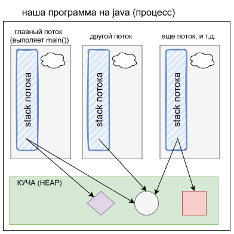
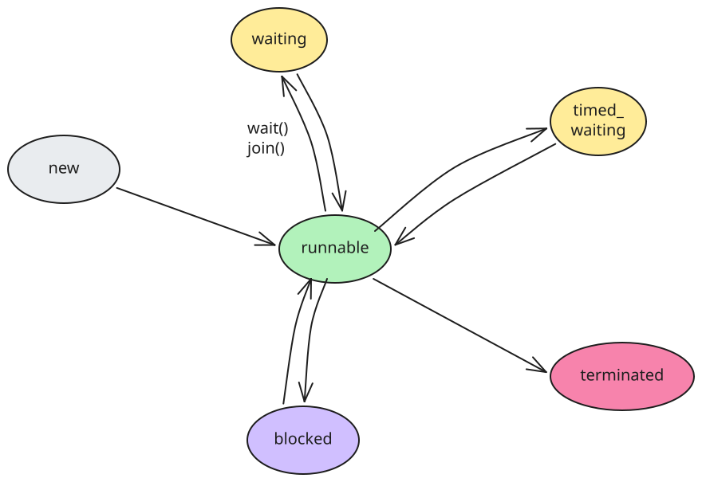
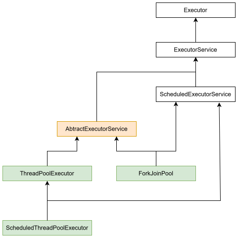
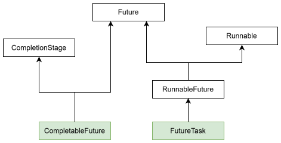

# Процесс и поток - что такое

## Ментальная модель процесса и потока

- Процессы и потоки в каждой ОС реализованы по-разному, нет смысла лишний раз думать об их реальном устройстве, лучше думать о них концептуально.
- Концептуально `процесс` - это выполняющаяся программа, которой выделен свой участок памяти (память процесса)
  - Процессы изолированы друг от друга на уровне ОС. Могут общаться только через специальные механизмы ОС (`IPC` - Inter-Process Communication). Межпроцессное взаимодействие к многопоточке не относится.
- `Поток` концептуально - это "рабочая единица", которая выполняет код. Когда создается процесс, тогда создается и поток, в котором выполняется функция main.
  - В main можно создать другие потоки - получится многопоточная программа.
- ОС переключает потоки - поток работает какое-то время, потом приостанавливается, начинает работать другой поток и так по кругу. ОС выделяет потоку квант времени и отправляет его работать. Когда квант исчерпан, управление возвращается к ОС, она выбирает следующий поток, дает ему квант и отправляет работать. И т.д.



## Куча и стек

- У процесса есть `куча` (heap) - это область памяти, в которой хранятся ссылочные типы данных. Например, сделали new ArrayList() - объект списка хранится в куче.
- У каждого потока есть персональный `стек` - это область памяти, в которой хранятся агрументы, передаваемые в функции, и локальные переменные функций. Очевидно, эта область памяти находится в границах памяти процесса.
  - Например, в main создали несколько переменных - они хранятся в стеке потока.
- Т.о. куча - одна на все потоки, а стек у каждого потока - свой.
  - В стеке хранятся примитивные типы данных, а на объектные хранятся ссылки, потому что как уже говорилось, объекты создаются в куче. Соответственно, когда у разных потоков есть ссылка на один и тот же объект в куче и они его как-то меняют, то возникают проблемы многопоточности.


# Описываем код потока

## Класс Thread

- https://docs.oracle.com/en/java/javase/26/docs/api/java.base/java/lang/Thread.html
- Класс Thread лежит в основе многопоточности в джаве. Все остальные механизмы в итоге сводятся так или иначе к нему.

```java
class MyThread extends Thread {  // <-- Наследуемся от Thread
    @Override
    public void run() {  // <-- Сюда пишем код, который хотим выполнять в потоке
        System.out.println("Поток: " + Thread.currentThread().getName());
    }
}
```

- Наследование от Thread - один из, но не лучший способ пользоваться многопоточкой.
  - Потому что
    - Из-за того что в джаве нет множественного наследования, наследоваться от Thread может быть неудобно. Хочешь расширить бизнес-логику через наследование + сделать код многопоточным, получаешь облом, потому что наследоваться можно только от одного класса.
    - "Голый" Thread
      - Не умеет возвращать результат работы.
      - Не умеет соединяться в цепочки.
      - Много чего еще не умеет.
- Но тем не менее он основа всего и все остальное является разнообразной накруткой поверх него.


## Функциональный интерфейс Runnable

- Концептуально Runnable - это "задача без результата".
- https://docs.oracle.com/en/java/javase/26/docs/api/java.base/java/lang/Runnable.html

```java
class MyTask implements Runnable {  // <-- Через интерфейс удобнее добавлять многопоточность классу
    @Override
    public void run() {  // <-- Тоже реализуем метод run
        System.out.println("Поток: " + Thread.currentThread().getName());
    }
}
```

- Runnable vs Thread
  - В джаве нет множественного наследования, поэтому если мы хотим выстроить через наследование бизнес-логику, то многопоточность внедрять в эту структуру через наследование будет не удобно. А интерфейсов классу можно добавлять сколько хочешь, поэтому добавление многопоточности классу через реализацию Runnable зачастую удобнее, чем через наследование от Thread.
  - Сам Thread тоже реализует Runnable. Метод run у треда именно от этого интерфейса.


## Функциональный интерфейс Callable

- Концептуально Callable - это "задача с результатом".
- https://docs.oracle.com/en/java/javase/26/docs/api/java.base/java/util/concurrent/Callable.html

```java
class MyTask implements Callable<String> {  // <-- Указываем тип результата
    @Override
    public Integer call() throws Exception {  // <-- Вместо run тут call
        return 23;  // <-- Можно вернуть результат
    }
}
```

- Thread и Runnable не предполагают возврат результата. Поэтому если нужно что-то вычислить в потоке и вернуть результат - пользуемся `Callable`.
- В этом конспекте я его упомянул просто чтобы было. Подробно писать здесь о нем не буду, сделаю это в отдельном конспекте.
- TODO: 
  - throws Exception тут зачем?


## Оформление кода через лямбду

- Для описания тела потока не обязательно писать отдельный класс, можно воспользоваться лямбдами.
- Лямбды и Thread

```java
Thread t = new Thread(() -> {  // <-- Передаем лямбду в конструктор
    System.out.println("Поток: " + Thread.currentThread().getName());
});
```

- Лямбды и Runnable \ Callable:

```java
Runnable task = () -> {
    System.out.println(Thread.currentThread().getName() + " runnable выполняется.");
};
```

```java
Callable<String> task = () -> {
    System.out.println(Thread.currentThread().getName() + " callable выполняется.");
    return "23 - Nichts ist so wie es scheint";
};
```

- Лямбду можно передавать в любые места, где ожидается Runnable или Callable.


# Запускаем поток в работу

## Метод .start()

- https://docs.oracle.com/en/java/javase/26/docs/api/java.base/java/lang/Thread.html#start()
- В самом базовом случае, чтобы запустить поток, мы создаем экземпляр Thread и вызываем на нем метод `.start()`:

```java
public class Demo {
    public static void main(String[] args) {
        Thread t = new MyThread();
        t.start();
    }
}

class MyThread extends Thread {
    @Override
    public void run() {
        System.out.println("Я работаю");
    }
}
```

- Повторно запускать поток нельзя. Один экземпляр - один поток. Когда метод run отработал до конца, поток уничтожается.


## Важное отличие методов run() и start()

- Метод `run()` - это просто обычный метод. Если его вызвать, то код просто выполнится в текущем потоке, как и любой другой обычный метод.
- Метод `start()` содержит всю многопоточную "обвязку". Его вызов создает новый поток и выполняет в нем код, описанный в методе run.
- Поэтому запускать поток надо именно через start().


## Другие способы запуска

- Кроме "ручного" запуска через .start() существуют и другие способы запуска потоков. О них будут отдельные конспекты.
  - Например
    - Запуск через пул.
    - Запуск через CompletableFuture.
  - Чтобы не перегружать базовый конспект, все подобные вещи я напишу в отдельных, а здесь просто упоминания оставлю, чтобы было примерно понятно, про что еще можно почитать.


## Пример с Runnable

- Непосредственно саму по себе runnable-задачу запустить нельзя, потому что Runnable это просто интерфейс, он нужен только для описания задачи и не обладает механиками создания потока.
- Поэтому для выполнения задачи мы либо передаем ее в Thread, либо в пул потоков, либо еще куда-то где принимают Runnable.
  - Например, через Thread:

```java
public class Demo {
    public static void main(String[] args) {
        Thread t = new Thread(
            new MyRunnableTask()
        );
        t.start();
    }
}

class MyRunnableTask implements Runnable {
    @Override
    public void run() {
        System.out.println("runnable задача работает");
    }
}
```

- То же самое через лямбду:

```java
public class Demo {
    public static void main(String[] args) {
        Thread t = new Thread(() -> {
            System.out.println("runnable задача работает");
        });
        t.start();
    }
}
```


## Пример с Callable

- Пример просто для "расширения кругозора", он сильно забегает вперед, но в целом прикольный, поэтому решил не выбрасывать.
- Callable-задачи обычно запускают с помощью пула.
- Запустить Callable непосредственно через Thread так же, как мы сделали с Runnable, не выйдет.
  - Дело в том, что Thread работает исключительно с Runnable.
  - Но поскольку все механизмы многопоточки под капотом все равно сводятся к использованию Thread, то и Callable, и все остальное в итоге является просто хитрой оберткой над базированным Runnable.
  - Очень примерно это можно представить как-то так:

```java
Callable<Integer> task = () -> 23;

FutureTask<Integer> futureTask = new FutureTask<>(task);
Thread thread = new Thread(futureTask);
thread.start();
Integer result = futureTask.get();
```

- Если интересно, вот дока по [FutureTask](https://docs.oracle.com/en/java/javase/26/docs/api/java.base/java/util/concurrent/FutureTask.html). Этот класс реализует и Runnable, и Future, поэтому его можно и в тред передать, и результат получить.


# Разновидности потоков

## Нативные и виртуальные потоки

- Нативные потоки - это настоящие потоки ОС, которые JVM создает и управляет через механизмы самой ОС.
- Виртуальные потоки появились в Java 21. Эти потоки JVM создает и управляет самостоятельно, без ОС. 
  - Конечно они выполняются внутри реальных потоков ОС, но сами по себе являются просто какими-то программными сущностями внутри JVM, которые она хитро монтирует \ размонтирует туда-сюда на реальные потоки.
- Грубо говоря, если создать просто 100 обычных инстансов Thread, то это будет 100 нативных потоков ОС, т.е. отношение "созданные нами потоки : потоки ОС" будет 1:1. А если создать 100 виртуальных потоков, то это отношение не будет 1:1, все это само распределится грамотнее и аккуратнее. Поэтому виртуальных потоков можно создавать гораздо больше, чем нативных.
- По умолчанию когда мы создаем поток через `new Thread()` он нативный. Виртуальный можно создать например через `Thread.ofVirtual()` или `Thread.startVirtualThread()`.
- TODO: объяснение годится для самого стартового понимания, там есть разные нюансы, явление `pinning`, критические секции в коде влияют на производительность и т.д. В моменте разобраться просто невозможно, стоит к этой теме вернуться предметно на конкретной проблеме \ задаче, иначе вейст времени будет пытаться разобраться "абстрактно".


## daemon и не-daemon (user) потоки

- `user thread` (или "не-daemon") потоки - это потоки, которые концептуально предназначены для выполнения полезной "бизнес-работы".
  - JVM не завершается, пока есть работающие юзер-треды. Она дожидается, пока они доработают.
- `daemon` потоки - это потоки, которые концептуально являются вспомогательными, "обслуживающими".
  - Демонов JVM не дожидается. Демоны могут прерваться внезапно, поэтому в них нельзя напрямую открывать ресурсы, потому что они могут быть не закрыты корректно.
- TODO: вписать реальные примеры, когда попадется хороший и наглядный, безо всякого этого "логирования, мониторинга" и прочего нейробреда.


# Жизненный цикл потоков



- TODO: мб еще добавить на картинку методы, при которых переход происходит?
- Состояния
  - `new` - поток просто создан через new и его еще не запускали.
  - `runnable` - когда на потоке вызвали .start(). Причем физически поток мог еще не начать работу, а просто сидит ждет выделения ресурсов, но состояние уже runnable.
  - `blocked` - когда поток пытается захватить монитор (входит в syncronized-участок кода), а монитор уже занят.
  - `terminated` - метод run выполнился, т.о. поток завершился и подлежит уничтожению.
  - `waiting` - TODO
  - `time_waiting` - TODO
- Детали
  - blocked и waiting на уровне ОС это одно и то же. Отличаются они в JVM, как маркеры причины ожидания.


# Взаимодействие с потоком

## Прерывание выполнения

- Метод `.interrupt()` у объекта потока. Он устанавливает флаг прерывания `isInterrupted` в true.
  - https://docs.oracle.com/en/java/javase/26/docs/api/java.base/java/lang/Thread.html#interrupt()
  - Сам по себе ни вызов метода, ни установка флага поток не прерывают, это просто как сигнал "давай заканчивай", а мы уже внутри кода потока сами должны этот флаг проверять и если он установлен, то завершать поток.
    - Под завершением потока подразумевается, по сути, выполнить до конца метод run. Например, если у нас поток крутит бесконечный цикл, в котором выбирает сообщения из очереди, то мы просто доделываем очередной шаг цикла и выходим из него через break например. Ну и выполняем классическую "очистку ресурсов" и т.д. Или если в потоке не цикл, а просто какая-то тяжелая долгая работа, состоящая из нескольких шагов, то можно например после каждого шага можем проверять флаг и если он установлен, то не делать остальные шаги. В общем, "завершить поток" это не какая-то магия, а просто дать методу run завершиться.
  - Методы вроде sleep(), wait(), join() переводят поток в состояние ожидания. Если вызвать .interrupt() на потоке, который в этот момент "отдыхает", то эти методы выбрасывают исключение `InterruptedException`. Оно проверяемое, поэтому компилятор заставит обработать либо пробросить.
    - При возникновении этого исключения флаг прерывания сбрасывается в false. Обычно его надо после отлова исключения руками вернуть в true, чтобы вызывающий код, который приказал потоку прерваться, видел что поток прерван.
      - TODO: Почему исключение сбрасывает флаг? Надо как-нибудь заморочиться и логику такого решения понять. Она довольно призрачная, вроде бы и понятно, но смутно. Пока просто как факт.


## Дождаться завершения потока

- Метод `.join()` у объекта потока. Есть перегрузка с указанием времени, сколько ждать.
  - https://docs.oracle.com/en/java/javase/26/docs/api/java.base/java/lang/Thread.html#join()
  - Если в потоке T вызывать `P.join()`, тогда T будет ждать, пока закончится P.
    - T переходит в состояние WAITING или TIMED_WAITING.


## Подождать-уведомить

- `.wait()`, `.notify()`, `.notifyAll()`
  - Это методы Object, а не инстанса треда.
  - Они связаны с темой syncronized-секций (sync далее для краткости).
  - https://docs.oracle.com/en/java/javase/26/docs/api/java.base/java/lang/Object.html#wait()
  - https://docs.oracle.com/en/java/javase/26/docs/api/java.base/java/lang/Object.html#notify()
  - https://docs.oracle.com/en/java/javase/26/docs/api/java.base/java/lang/Object.html#notifyAll()
- wait() надо вызывать на объекте-мониторе обязательно изнутри sync. 
  - Потому что когда поток заходит в sync, он захватывает монитор, а вызов wait() подразумевает что монитор должен быть захвачен. Тогда поток атомарно отпустит монитор и станет WAITING.
  - wait() положено вызывать внутри цикла while с условием ухода в ожидание. Потому что возможны "спонтанные" пробуждения потока и он должен в таком случае снова уйти в ожидание. Через if так не получится сделать.
- notify() и notifyAll() надо вызывать на том же мониторе, на котором вызывали wait().
  - notify() будит один из ожидающих потоков (случайный).
  - notifyAll() будит все ожидающие потоки.
- Вызов notify() может сделать deadlock, поэтому предпочтительнее вызывать notifyAll().
  - Как может получиться дедлок?
    - Например, есть два продюсера и один консюмер. Консюмер уходит в ожидание когда очередь пуста (т.к. ему нечего обрабатывать), а продюсеры - когда заполнена (некуда класть). Предположим, мы оказываемся в ситуации, когда консюмер и один из продюсеров ждут, а второй продюсер работает. Он положил данные в последний слот очереди и вызвал notify(), который разбудил случайного "ждуна" и этим ждуном оказался первый продюсер, а не консюмер. Тогда проснувшийся продюсер увитит, что очередь заполнена и уйдет в ожидание. И другой продюсер тоже уйдет в ожидание, а консюмер так и не проснулся - дедлок.
      - 🤔 Тут важна модель мышления: если думать последовательно, то будет не понятно, как вообще может получиться ситуация, когда один продюсер и консюмер спят, а другой продюсер работает. В многопоточке последовательности четкой нет, в том и суть. "Раз в год и палка стреляет" - тут такой же принцип, если ситуация может случиться, она обязательно случится, хоть изредка, но случится. Поэтому лучше думать именно ситуациями - "возможна ли ситуация дедлока? да, возможна: продюсер и консюмер ждут, другой продюсер работает, дает уведомление - просыпается не консюмер, а продюсер -> сообщения не читаются, очердь заполняется -> продюсеры ждут и консюмер ждет = дедлок".
    - В общем тут проблема в том, что на одном и тот же мониторе ожидание идет по двум разным условиям, но "пользователи" монитора этих условий не различают.
  - Вызов notifyAll() позволяет избежать дедлока, потому что пробудятся все ждуны, каждый проверит условие и если что, заново уйдет ждать, а тот кому положено работать, гарантированно будет работать. Будить всех это дольше, зато надежне.
- "Голые" wait-notify считаются лоу-левел api, для повседневной практики есть средства удобнее.


- Пример с возможным дедлоком:

```java
public class NotifyBugDemo {

    static final Object lock = new Object();
    static Integer item = null;   // буфер на 1 элемент

    // ---------- PRODUCER ----------
    static class Producer implements Runnable {
        private final int id;

        Producer(int id) { this.id = id; }

        @Override
        public void run() {
            try {
                while (true) {
                    synchronized (lock) {
                        // ждём, пока буфер освободится
                        while (item != null) {
                            System.out.println("P" + id + ": буфер занят, wait()");
                            lock.wait();
                        }
                        item = id;
                        System.out.println("P" + id + ": положил " + id);
                        lock.notify();
                    }
                    Thread.sleep(300);
                }
            } catch (InterruptedException e) {
                Thread.currentThread().interrupt();
            }
        }
    }

    // ---------- CONSUMER ----------
    static class Consumer implements Runnable {
        @Override
        public void run() {
            try {
                while (true) {
                    synchronized (lock) {
                        // ждём, пока появятся данные
                        while (item == null) {
                            System.out.println("C : пусто, wait()");
                            lock.wait();
                        }
                        System.out.println("C : забрал " + item);
                        item = null;
                        lock.notify();
                    }
                    Thread.sleep(300);
                }
            } catch (InterruptedException e) {
                Thread.currentThread().interrupt();
            }
        }
    }

    public static void main(String[] args) {
        new Thread(new Producer(1), "P1").start();
        new Thread(new Producer(2), "P2").start();
        new Thread(new Consumer(),  "C").start();
    }
}
```


- Как бы это же можно было сделать без угрозы дедлока:

```java
import java.util.LinkedList;
import java.util.Queue;
import java.util.concurrent.locks.Condition;
import java.util.concurrent.locks.ReentrantLock;

public class ConditionDemo {
    static final int CAPACITY = 2;

    static final ReentrantLock lock = new ReentrantLock();
    static final Condition notFull  = lock.newCondition();  // ждут Producer'ы
    static final Condition notEmpty = lock.newCondition();  // ждёт Consumer

    static final Queue<Integer> buffer = new LinkedList<>();

    // ---------- PRODUCER ----------
    static class Producer implements Runnable {
        private final int id;

        Producer(int id) { this.id = id; }

        @Override
        public void run() {
            try {
                while (true) {
                    lock.lock();                    // захватываем замок
                    try {
                        // ждём, пока буфер НЕ полон — в СВОЕЙ очереди notFull
                        while (buffer.size() == CAPACITY) {
                            System.out.println("P" + id + ": полон, await(notFull)");
                            notFull.await();
                        }

                        buffer.add(id);
                        System.out.println("P" + id + ": положил " + id + ", size=" + buffer.size());

                        // будим ТОЛЬКО тех, кто ждёт "не пусто" (Consumer'ов)
                        notEmpty.signalAll();
                    } finally {
                        lock.unlock();              // обязательно в finally
                    }

                    Thread.sleep(300);
                }
            } catch (InterruptedException e) {
                Thread.currentThread().interrupt();
            }
        }
    }

    // ---------- CONSUMER ----------
    static class Consumer implements Runnable {
        @Override
        public void run() {
            try {
                while (true) {
                    lock.lock();
                    try {
                        // ждём, пока буфер НЕ пуст — в СВОЕЙ очереди notEmpty
                        while (buffer.isEmpty()) {
                            System.out.println("C : пусто, await(notEmpty)");
                            notEmpty.await();
                        }

                        int value = buffer.poll();
                        System.out.println("C : забрал " + value + ", size=" + buffer.size());

                        // будим ТОЛЬКО тех, кто ждёт "не полон" (Producer'ов)
                        notFull.signalAll();
                    } finally {
                        lock.unlock();
                    }

                    Thread.sleep(300);
                }
            } catch (InterruptedException e) {
                Thread.currentThread().interrupt();
            }
        }
    }

    public static void main(String[] args) {
        new Thread(new Producer(1)).start();
        new Thread(new Producer(2)).start();
        new Thread(new Consumer()).start();
    }
}
```

- LinkedList не потокобезопасен, но в данном случае это ок, потому что вся работа явно защищена через lock.


## sleep

- TODO:


# Исключения в потоках

- Исключения не пробрасываются в родительский поток
  - Если в потоке происходит исключение и мы его там не ловим, то оно выводится в System.err (стандартный поток вывода ошибок) и поток завершается.
  - Т.е. в "родительский" поток исключение не пробрасывается ни при каких обстоятельствах, нет такой механики.
- Обработчик непойманных исключений
  - На объект потока можно повесить обработчик, который будет вызываться при возникновении непойманного исключения
    - `t.setUncaughtExceptionHandler((thread, ex) -> { })`
  - Можно задать универсальный обработчик для всех потоков разом
    - `Thread.setDefaultUncaughtExceptionHandler((thread, ex) -> { })`
- 


## Исключения в пулах, Future

- Обработчики непойманных исключений не срабатывают для потоков, которые выполняются в пуле.
  - Это потому что пулы возвращают нам Future, а Future сам перехватывает непойманное исключение и сохраняет в себе.

```java

```


## TODO

- ThreadPoolExecutor.afterExecute

# Пулы потоков

## Зачем нужны пулы

- Каждый раз создавать новый поток - накладно, потому что задействуются механизмы ОС, выделяется \ освобождается память и т.д. Поэтому эффективнее использовать пулы потоков. Поток берется из пула, в нем выполняется задача, после этого поток возвращается в пул.
- Пулы позволяют контролировать количество потоков, очереди задач и т.д. В общем, пулы - это более продвинутый способ работы с потоками, нежели "голый" запуск.
- TODO: Дополнительные вещи, вроде когда все потоки заняты, очередь


## Иерархия интерфейсов и классов

| Интерфейс                  | Возможности                                                  | Дока                                                         |
| -------------------------- | ------------------------------------------------------------ | ------------------------------------------------------------ |
| `Executor`                 | 🔸Интерфейс с единственным методом execute(). Его базовая задача - отвязать выполнение задачи от явного создания потока. Т.е. вместо того чтобы сами морочиться с созданием потока, мы просто отправляем задачу в Executor и он сам все создает. 🔸Выполнение самое простецкое - "отправил и забыл", без возможности получить результат, без возврата Future. 🔸Отправить на выполнение умеет только одну задачу. | [Читать](https://docs.oracle.com/en/java/javase/26/docs/api/java.base/java/util/concurrent/Executor.html) |
| `ExecutorService`          | 🔸Продвинутое расширение Executor'а. 🔸Позволяет отправлять несколько задач на выполнение. 🔸При отправке задачи на выполнение возвращает нам Future, что позволяет нам взаимодействовать с выполняющимися задачами. | [Читать](https://docs.oracle.com/en/java/javase/26/docs/api/java.base/java/util/concurrent/ExecutorService.html) |
| `ScheduledExecutorService` | 🔸 TODO                                                       | [Читать](https://docs.oracle.com/en/java/javase/26/docs/api/java.base/java/util/concurrent/ScheduledExecutorService.html) |




## Создаем пул

### Executors - готовые пулы потоков

- https://docs.oracle.com/en/java/javase/26/docs/api/java.base/java/util/concurrent/Executors.html
- В классе `Executors` много статических методов, которые возвращают преднастроенные пулы, например:

```java
ExecutorService pool = Executors.newFixedThreadPool(4);
ExecutorService pool = Executors.newCachedThreadPool();
ExecutorService pool = Executors.newSingleThreadExecutor();
// и т.д., там много разных, выбираем какой надо
```

- Обзор имеющихся готовых пулов сделаю в отдельном разделе про настройку пула.
- Все они по сути просто создают пулы из показанных на схеме классов, передавая в них определенные параметры.


### Создание пула самостоятельно

- Если настройки готовых пулов нам не подходят, можно создать пул самостоятельно из классов:

| Классы                        | Документация                                                 |
| ----------------------------- | ------------------------------------------------------------ |
| `ThreadPoolExecutor`          | [Читать](https://docs.oracle.com/en/java/javase/26/docs/api/java.base/java/util/concurrent/ThreadPoolExecutor.html) |
| `ForkJoinPool`                | [Читать](https://docs.oracle.com/en/java/javase/26/docs/api/java.base/java/util/concurrent/ForkJoinPool.html) |
| `ScheduledThreadPoolExecutor` | [Читать](https://docs.oracle.com/en/java/javase/26/docs/api/java.base/java/util/concurrent/ScheduledThreadPoolExecutor.html) |

- Делать это приходится, похоже, не так уж редко. TODO: правда разбираться в этом сейчас я, конечно же, не буду.
- Пример создания пула самостоятельно:

```java
ThreadPoolExecutor executor = new ThreadPoolExecutor(
    4,
    8,
    60L, TimeUnit.SECONDS,
    new ArrayBlockingQueue<>(100),
    new ThreadFactoryBuilder().setNameFormat("img-resize-%d").build(),
    new ThreadPoolExecutor.CallerRunsPolicy()
);
```

- Краткое описание параметров - в отдельном разделе про настройки пула.


## Отправляем задачу в пул

- https://docs.oracle.com/en/java/javase/26/docs/api/java.base/java/util/concurrent/ExecutorService.html#submit(java.lang.Runnable)

```java
Future<?> future = pool.submit(() -> {
    System.out.println(Thread.currentThread().getName() + " runnable выполняется в пуле.");
});
```

```java
Future<Integer> future = pool.submit(() -> {
    System.out.println(Thread.currentThread().getName() + " callable выполняется в пуле.");
    return 23;
});
```

- TODO: вероятно тут можно отправлять по одной задаче, а можно пачку? через invokeAll?


## Закрыть пул

- TODO:


# Настройки пула

## ThreadPoolExecutor

- [Конструктор со всеми доступными параметрами](https://docs.oracle.com/en/java/javase/26/docs/api/java.base/java/util/concurrent/ThreadPoolExecutor.html#%3Cinit%3E(int,int,long,java.util.concurrent.TimeUnit,java.util.concurrent.BlockingQueue,java.util.concurrent.ThreadFactory,java.util.concurrent.RejectedExecutionHandler))

```java
ThreadPoolExecutor executor = new ThreadPoolExecutor(
    1,  // corePoolSize
    2,  // maximumPoolSize
    0L, // keepAliveTime
    TimeUnit.MILLISECONDS,  // unit
    new ArrayBlockingQueue<>(2),  // workQueue
    null,  // threadFactory
    new ThreadPoolExecutor.AbortPolicy()  // handler
);
```


### Простые настройки

- `corePoolSize` - количество потоков, которые всегда остаются в пуле, даже если простаивают.
- `maximumPoolSize` - максимальное количество потоков в пуле.
- `keepAliveTime` - время, после которого простаивающие потоки будут уничтожены.
- `unit` - единицы времени для keepAliveTIme.
- `threadFactory` - фабрика создания потоков, позволяет например задать имена потокам и разные другие полезные вещи.


### Настройка workQueue

- `workQueue` - это инстанс очереди, которая используется для хранения поступающих задач, когда количество созданных потоков в пуле добралось до corePoolSize.
- У пула есть внутренний счетчик workerCount, который хранит количество созданных потоков. Когда этот счетчик становится >= corePoolSize, тогда именно от выбранного типа очереди зависит, что будет происходить дальше.
  - Если очередь приняла задачу, тогда новый поток не создается. Если не приняла - тогда пул пытается создать новый поток, если еще не достигнут maximumPoolSize. Ну а если он достигнут, получается что пул не может обработать задачу и тогда срабатывает `handler` - последняя настройка - который определит, что делать с такой задачей.
- Некоторые типичные инстансы для workQueue (все они должны реализовать интерфейс BlockingQueue):
  - [SynchronousQueue](https://docs.oracle.com/en/java/javase/26/docs/api/java.base/java/util/concurrent/SynchronousQueue.html) - очередь не хранит ни одной задачи, пул быстро растет до maximumPoolSize.
    - P.S. Можно почитать по какому принципу работает эта очередь, я что-то сходу не понял.
  - [LinkedBlockingQueue](https://docs.oracle.com/en/java/javase/26/docs/api/java.base/java/util/concurrent/LinkedBlockingQueue.html) - эта очередь не имеет размера, поэтому задачи кладутся в нее бесконечно, пока хватит физической памяти. Так что количество потоков никогда не превысит corePoolSize.
  - [ArrayBlockingQueue](https://docs.oracle.com/en/java/javase/26/docs/api/java.base/java/util/concurrent/ArrayBlockingQueue.html) - очередь с фиксированным размером. Работает описанный выше алгоритм "приняла - храним, не приняла - новый поток, нельзя новый поток - handler".
- Думаю что создание и настройка собственного пула потянет на отдельную полноценную тему, так что тут просто обзорно оставлю.
- TODO: мб нарисовать это блок-схемой, когда словами разберусь?


### Настройка handler, принцип backpressure

- `RejectedExecutionHandler handler` - параметр задает, что делать в ситуации, когда пул не может принять задачу.
  - Например, очередь переполнена + потоков уже создано максимум, или пул пытается закрыться (shutdown).
- Есть несколько предустановленных политик
  - [AbortPolicy](https://docs.oracle.com/en/java/javase/26/docs/api/java.base/java/util/concurrent/ThreadPoolExecutor.AbortPolicy.html) - дефолт, выбрасывает исключение RejectedExecutionException.
  - [CallerRunsPolicy](https://docs.oracle.com/en/java/javase/26/docs/api/java.base/java/util/concurrent/ThreadPoolExecutor.CallerRunsPolicy.html) - задачу будет выполнять поток, который попытался отправить ее в пул (пул как бы говорит "я не могу, сам выполняй!").
  - [DiscardPolicy](https://docs.oracle.com/en/java/javase/26/docs/api/java.base/java/util/concurrent/ThreadPoolExecutor.DiscardPolicy.html) - задача просто выбрасывается безо всяких исключений или других сигналов.
  - [DiscardOldestPolicy](https://docs.oracle.com/en/java/javase/26/docs/api/java.base/java/util/concurrent/ThreadPoolExecutor.DiscardOldestPolicy.html) - из очереди выбрасывается самая старая задача, а новая добавляется.
- Типичные проблемы:
  - Если отбрасывать задачи, получаем потерю данных.
  - Если копить задачи в безлимитной очереди, получаем OOM (OutOfMemory).
- Принцип `backpressure`
  - Эти проблемы возникают из-за того, что поставщик задач генерит больше задач, чем потребитель (пул) может обработать.
  - Поэтому при перегрузке пула логичнее всего затормозить поставщика, чтобы он перестал давать задачи. Это называется backpressure.
  - Для этого мы можем написать свою политику: реализуем интерфейс RejectedExecutionHandler, отдаем реализацию в пул и радуемся. Как именно сделать такое управляемое торможение поставщика - отдельная тема.


## Обзор готовых пулов

- У всех готовых пулов есть общие характеристики:
  - Они используют политику AbortPolicy при невозможности принять задачу.
  - Они создают не-daemon потоки.
  - У создаваемых потоков нормальный приоритет.
  - Имена потокам даются в виде pool-N-thread-M.
  - Почти все пулы используют неограниченную очередь для сообщений. Поэтому они не годятся для работы под нагрузкой, можно получить OOM.
  - Многие пулы по умолчанию используют нативные потоки ОС.
    - Но у многих методов создания пулов есть версия с параметром threadFactory. Это позволяет нам передать фабрику, в которой мы можем создавать виртуальные потоки вместо нативных.
- Обзор пулов:

| Метод \ пул                                                  | Описание пула                                                |
| ------------------------------------------------------------ | ------------------------------------------------------------ |
| [newFixedThreadPool(n)](https://docs.oracle.com/en/java/javase/26/docs/api/java.base/java/util/concurrent/Executors.html#newFixedThreadPool(int)) | 🔸 Пул с фиксированным количеством потоков. Больше чем указано, их не будет создано. Если все потоки заняты, задачи помещаются в очередь. 🔸 Но после создания пула количество потоков в нем можно вручную изменить. |
| [newWorkStealingPool(parallelism)][https://docs.oracle.com/en/java/javase/26/docs/api/java.base/java/util/concurrent/Executors.html#newWorkStealingPool(int)] | TODO, что-то связанное с ForkJoinPool, нет гарантий порядка выполнения |
| [newSingleThreadExecutor](https://docs.oracle.com/en/java/javase/26/docs/api/java.base/java/util/concurrent/Executors.html#newSingleThreadExecutor()) | Пул с единственным потоком. Отличается от newFixedThreadPool(1) тем что тут невозможно после создания пула никак изменить руками количество потоков, потому что возвращается не "настоящий" пул, а обертка и она такой возможности не дает. |
| [newCachedThreadPool](https://docs.oracle.com/en/java/javase/26/docs/api/java.base/java/util/concurrent/Executors.html#newCachedThreadPool()) | Пул с динамическим количеством потоков. Задачи в очереди не хранятся, поэтому если задача приходит, а все потоки заняты, то создается новый. Если свободный поток простаивает 60 сек, то он уничтожается. |
| [newThreadPerTaskExecutor(threadFactory)](https://docs.oracle.com/en/java/javase/26/docs/api/java.base/java/util/concurrent/Executors.html#newThreadPerTaskExecutor(java.util.concurrent.ThreadFactory)) | 🔸 Этот пул создает для каждой пришедшей задачи новый поток. От newCachedThreadPool отличается тем, что не кэширует потоки. Как только поток выполнил задачу, он уничтожается. 🔸 Особенность в том, что тут мы обязаны передать фабрику создания потоков. Легенды гласят, что метод был создан для упрощения перехода на виртуальные потоки. |
| [newVirtualThreadPerTaskExecutor](https://docs.oracle.com/en/java/javase/26/docs/api/java.base/java/util/concurrent/Executors.html#newVirtualThreadPerTaskExecutor()) | То же самое что newThreadPerTaskExecutor, но только за нас уже передают готовую фабрику виртуальных потоков. |
| TODO: есть еще несколько                                     |                                                              |


TODO: что по гарантиям порядка выполнения задач? пулы дают его?

# Фабрика потоков

- Фабрика представлена функциональным интерфейсом `ThreadFactory`, с единственным методом newThread.
- Мы можем написать класс, реализующий этот интерфейс, и передать его инстанс туда, где требуется фабрика, например в пул. Тогда он для создания потока будет пользоваться этой фабрикой.
  - Фабрика сама по себе, вне этого контекста, как какая-то самостоятельная сущность не используется.
- Можно не писать отдельный класс, а воспользоваться лямбдой.
- TODO: 
  - у фабрики много возможностей, от простых вещей, вроде задания имени, до более продвинутых вроде обработчиков исключений, daemon - не-daemon и т.д. Там достаточно много вещей, которые можно сделать. Потом вписать.
  - Одной из важнейших возможностей является создание в фабрике не нативного потока ОС, а виртуального. Такую фабрику можно использовать при создании пула потоков и тогда он будет пользоваться виртуальными потоками.


# Future, CompletableFuture


## Иерархия интерфейсов и классов

- P.S. Иерархия не полная, только самое базированное, что понял на данный момент.



| Интерфейс         | Возможности                                                  | Дока                                                         |
| ----------------- | ------------------------------------------------------------ | ------------------------------------------------------------ |
| `Future`          | 🔸Базовые возможности для взаимодействия с отправленной в работу задачей: проверить состояние (завершена \ отменена); получить результат; отменить | [Читать](https://docs.oracle.com/en/java/javase/26/docs/api/java.base/java/util/concurrent/Future.html) |
| `CompletionStage` | 🔸Дает возможности по выстраиванию цепочек обработки, вроде "после выполнения задачи выполнить вот эту, после нее эту и т.д." | [Читать](https://docs.oracle.com/en/java/javase/26/docs/api/java.base/java/util/concurrent/CompletionStage.html) |
| `RunnableFuture`  | TODO                                                         | [Читать](https://docs.oracle.com/en/java/javase/26/docs/api/java.base/java/util/concurrent/RunnableFuture.html) |


TODO: как отмена работает?

## Future - интерфейс

- https://docs.oracle.com/en/java/javase/26/docs/api/java.base/java/util/concurrent/Future.html
- `Future` - это интерфейс, который позволяет работать с запущенной задачей.
  - Например, дождаться окончания выполнения, получить результат.
  - Когда мы отправляем задачу в пул, например через submit, то получаем в ответ Future.
  - 


## CompletableFuture

- https://docs.oracle.com/en/java/javase/26/docs/api/java.base/java/util/concurrent/CompletableFuture.html
- Умеет запускать задачи в работу. Для этого может пользоваться своим дефолтным пулом (TODO: что это за пул?) или мы можем сами ему передать наш пул.


# Примеры проблем многопоточности

## shared counter, неатомарность операций

- В чем проблема
  - Есть объект counter с int-полем value (значение)
  - Создается несколько потоков, у всех есть ссылка на этот counter, и они выполняют увеличение значения в цикле
  - Наивно ожидается что если 10 потоков сделают 1000 увеличений, конечное значение будет 10_000
    - Но это не так

```java
public class Counter {
    private int value = 0;

    public void increment() {
        value++;
    }

    public int get() {
        return value;
    }
}
```

```java
public class Main {
    public static void main(String[] args) throws InterruptedException {
        Counter counter = new Counter();

        Thread[] threads = new Thread[10];

        for (int i = 0; i < threads.length; i++) {
            threads[i] = new Thread(() -> {
                for (int j = 0; j < 1000; j++) {
                    counter.increment();
                }
            });
        }

        for (Thread thread : threads) {
            thread.start();
        }

        for (Thread thread : threads) {
            thread.join();
        }

        System.out.println(counter.get());
    }
}
```

- Почему не получается 10_000
  - Увеличение значения (value++, value += 1, value = value + 1 и т.д., не важно) - не атомарная операция. Т.е. она состоит из трех операций - "взять текущее значение", "вычислить новое", "записать вместо старого".
  - Поскольку квант времени может закончится в любой момент, то поток может не успеть записать результат. Соответственно, когда он вернется к работе, то запишет значение, которое вычислил в прошлый раз, и т.о. перезапишет результаты других потоков, которые работали после него. Поэтому часть "увеличений" счетчика и теряется.
  - Эта проблема называется `race condition`
  - TODO: стоит ли здесь сделать рисунок? Вроде бы для меня этот момент сейчас очевиден. Мб потом, когда делать нечего будет или выяснится, что забыл.


## ready-флаг, гарантии видимости изменений

- Суть проблемы
  - Наивно ожидаем увидеть 42, но возможны проблемы:
    - Видим 0
    - Ничего не видим, второй поток ничего не вывел
  - P.S. Хоть миллион раз запусти, эти проблемы могут не возникнуть, но это не доказывает, что их потенциально нет

```java
public class Main {

    public static void main(String[] args) throws InterruptedException {
        State state = new State();

        Thread writer = new Thread(() -> {
            state.number = 42;
            state.ready = true;
        });

        Thread reader = new Thread(() -> {
            if (state.ready) {
                System.out.println(state.number);
            }
        });

        writer.start();
        reader.start();

        writer.join();
        reader.join();
    }
}

class State {
    public int number = 0;
    public boolean ready = false;
}
```

- Почему проблемы
  - Потому что если не использовать специальные средства для работы с многопоточностью, то JVM не гарантирует видимость изменений, которые разные потоки делают над одними и теми же данными.
    - Это единственное приемлемое объяснение. Вся остальная чепуха насчет "реордеринга команд из-за оптимизаций", "кэширование" - вносит только путаницу, это попытки грубо объяснить очень низкоуровневые технические детали реализации, которые только извращают мышление, не давая реальной пользы.
  - Фактически это значит что если один поток записал number = 42 и ready = true, то другой поток может эти значения либо не увидеть вообще, либо увидеть частично. В общем, так и так получится ненадежная каша.
  - Чтобы таких проблем не было, нужна happens-before гарантия.


# happens-before гарантия

- `happens-before` ("происходит перед") связано с видимостью изменений данных, которые потоки вносят в общие данные.
- Абстрактно сформулировать можно так: "Если действие А происходит перед действием B, тогда действие B видит изменения, которые сделало действие А, причем ровно в том же порядке".
- Многие многопоточные фишки дают happens-before гарантию.
- Дб понятнее на конкретном примере: запись в volatile-поле "происходит перед" чтением из этого поля. На практике это значит, что если один поток пишет в volatile-поле, то другой поток гарантированно прочитает актуальное записанное значение. Без этой гарантии он может прочитать старое значение и никогда не увидеть новое.


# volatile - хочу актуальное значение

- `volatile`
  - Что дает
    - Гарантию видимости актуального значения
  - Чего не дает
    - атомарности операциям
  - К чему применяется
    - только к полям класса

```java
public class Worker implements Runnable {

    private volatile boolean running = true;  // <-- volatile

    @Override
    public void run() {
        System.out.println("Worker: начал работу");

        while (running) {
            System.out.println("Worker: работаю...");

            try {
                Thread.sleep(500);
            } catch (InterruptedException e) {
                Thread.currentThread().interrupt();
                break;
            }
        }

        System.out.println("Worker: остановлен");
    }

    public void stop() {
        running = false;
    }
}
```

```java
public class Main {
    public static void main(String[] args) throws InterruptedException {
        Worker worker = new Worker();

        Thread thread = new Thread(worker);
        thread.start();

        Thread.sleep(3000);

        System.out.println("Main: останавливаю Worker");

        worker.stop();

        thread.join();

        System.out.println("Main: программа завершена");
    }
}
```

- Объяснение
  - Создаем новый поток, в котором работает воркер
  - Потом из главного потока (в котором main выполняется), вызываем метод воркера, который пишет false в volatile-поле
  - Цикл while видит false и завершается. Когда run() метод доходит до конца, то в данном случае поток завершается.
  - Суть в том, что false пишется из главного потока, а читается из другого. Без volatile этот поток мог бы не увидеть изменение поля running и не остановился бы. volatile дает гарантию видимости актуального значения.


# syncronized - туалет занят, ждите

- `syncronized` - это ключевое слово, им можно помечать методы:

```java
public class BankAccount {
    private volatile int balance;

    public BankAccount(int balance) {
        this.balance = balance;
    }

    public synchronized void withdraw(int amount) {
        if (balance >= amount) {
            balance -= amount;
            System.out.println(Thread.currentThread().getName() + " снял " + amount);
        } else {
            System.out.println("Недостаточно средств");
        }
    }

    public synchronized void deposit(int amount) {
        balance += amount;
    }

    public int getBalance() {
        return balance;
    }

    public static void main(String[] args) throws InterruptedException {
        BankAccount account = new BankAccount(1000);

        Runnable task = () -> {
            account.withdraw(700);
        };

        Thread t1 = new Thread(task, "Thread-1");
        Thread t2 = new Thread(task, "Thread-2");

        t1.start();
        t2.start();

        t1.join();
        t2.join();

        System.out.println("Итоговый баланс: " + account.getBalance());
    }
}
```

- можно помечать блоки кода:

```java
public class PriceService {
    private final Object lock = new Object();
    private final Map<String, Integer> cache = new HashMap<>();

    public int getPrice(String productId) {
        // Быстрая проверка кэша — блокируем только доступ к Map
        synchronized (lock) {
            Integer cachedPrice = cache.get(productId);

            if (cachedPrice != null) {
                return cachedPrice;
            }
        }

        // Долгая операция выполняется БЕЗ блокировки
        int price = loadPriceFromDatabase(productId);

        // Снова короткий участок под блокировкой
        synchronized (lock) {
            cache.put(productId, price);
        }

        return price;
    }

    private int loadPriceFromDatabase(String productId) {
        // Представим, что здесь запрос к БД занимает 500 мс
        return 100;
    }
}
```

## Зачем нужно

- syncronized дает потоку монополию на участок кода - пока он полностью не выполнит syncronized-секцию, все остальные потоки, которые попробуют выполнить этот код, зависнут в ожидании.
- у каждого объекта есть `монитор`. syncronized захватывает этот монитор. если syncronized применяется к методу целиком, то это равнозначно syncronized (this), т.е. захватить монитор текущего объекта.
  - когда монитор освобождается, ОС берет один из зависших на нем потоков и ставит в работу.
- когда syncronized используется с блоком кода, то обычно делают отдельный объект для захвата, а не this. 
  - Это не позволяет внешнему коду случайно заблокировать секцию в PriceService. Например, какой-то внешний код взял и использовал объект PriceService для своей секции, которая вообще не имеет отношения к секциям внутри price service. Тогда если кто-то вызовет getPrice, то залипнет, потому что монитор price service'а занят.
- syncronized-блоки надо делать как можно меньше. Вся работа, которая не требует синхронизации, должна выполняться без нее, чтобы лишний раз не вешать потоки.


# Примитивы синхронизации

## mutex \ монитор

- `mutex` - (от mutual exclusion, взаимное исключение) - это примитив синхронизации, который подразумевает, что захватить его может только один поток. Если другой поток пытается захватить его, то уходит в блокировку, пока мьютекс не освободится.
- `монитор` - чем-то отличается от мьютекса вроде, но я не понял чем. Но по сути одно и то же - только один поток может захватить монитор, остальные блокируются до тех пор, пока монитор освободится.


# 📖 Что почитать

- https://habr.com/ru/articles/802113/


# TODO

- Методы эти посмотреть ~~join(), wait(), notify()~~, lock(), yield(), sleep(), unlock(), stop(), ~~iterrupt()~~


## wait \ notify

- Продвинутое ожидание \ уведомление

```java
private final ReentrantLock lock = new ReentrantLock();
private final Condition notFull  = lock.newCondition();
private final Condition notEmpty = lock.newCondition();

// Producer:
lock.lock();
try {
    while (buffer.size() == CAPACITY) notFull.await();
    buffer.add(value);
    notEmpty.signalAll();   // будим только ждущих "не пусто"
} finally {
    lock.unlock();
}
```

Сейчас `wait()`/`notify()` считаются низкоуровневым API. Обычно используют:

- `java.util.concurrent.locks.Condition` (`await()`/`signal()`)
- `BlockingQueue`, `CountDownLatch`, `Semaphore` и др.
- `CompletableFuture`


- ~~Способы объявить поток~~

  - ~~Наследование от класса `Thread`~~
  - ~~Реализация *функциональных* интерфейсов `Runnable` или `Callable`~~
  - ~~Лямбды~~

- ~~Запуск потока~~

  - ~~"Голый" запуск~~
  - ~~Пулы потоков, интерфейс ExecutorService~~

- Исключения в потоках

  - TODO

- Возврат значения из потока

- ~~Виды потоков~~

  - ~~daemon и "не-daemon" ("пользовательские")~~
  - ~~Виртуальные потоки~~

- Приоритет потоков

- ~~Жизненный цикл потоков~~

- Дополнительные вещи

  - ForkJoinPool
  - Виртуальные потоки
  - sleep() метод потока
  - isAlive(), getName(), setName(), setPriority(), getPriority()
  - yield()
  - Future, CompletableFuture, ScheduledFuture, CompletionService
  - FutureTask, 
  - ~~ExecutorService~~
  - отмена задач \ потока
  - ~~ThreadFactory~~
  - ThreadGroup??? - устаревшая хрень, но можно упомянуть для истории, чтобы явно знать что оно не нужно уже.
  - Что можно сделать непосредственно с потоком, его методы вроде join, sleep и т.д.
  - Асинхронные задачи что подразумевают тут? Это что-то отличающееся от многопоточки?

- TODO

  - Project  Loom

- Синхронизаторы (возможно в отдельном конспекте лучше?)

  - `CountDownLatch` — ждать N событий

    `CyclicBarrier` — синхронная точка для N потоков

    `Semaphore` — ограничение доступа к ресурсу

    `Phaser` — более гибкий barrier

    `Exchanger` — обмен данными между двумя потоками

- Locks

  - ```
    ReentrantLock`, `ReentrantReadWriteLock
    ```

    `StampedLock` (Java 8) — оптимистичные чтения

    `Condition` — аналог wait/notify