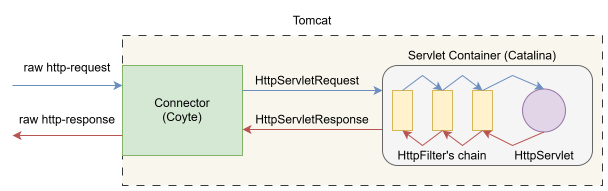

# Основа под Spring MVC

## Архитектура "сервлетов"

- Примерная схема того о чем пойдет речь




## Сервлеты

### Сервлеты - это спецификация из Jakarta

- `Java EE` и `Jakarta` - это синонимы. Это набор спецификаций для реализации серверных программ на джаве. Грубо говоря, преимущественно это набор интерфейсов, которые описывают концепцию системы, какие в ней компоненты, как они связаны и взаимодействуют. Одним словом, архитектура.
- Сервлеты - это одна из таких спецификаций.


### Что такое сервлет

- `Сервлет` - это по сути минимальный кирпич веб-приложения.
  - Технически это класс-наследник от HttpServlet, в котором есть специальные методы вроде doGet, doPost и т.д. Мы пишем в них код обработки запроса.
  - https://jakarta.ee/specifications/platform/11/apidocs/jakarta/servlet/http/httpservlet
  - Я тут под "сервлетом" буду подразумевать именно http-сервлет, а вообще есть еще как бы "сервлет общего назначения", но нас он не интересует.
- Как (примерно) пишется веб-приложение на сервлетах
  - Пишем сервлеты, отмечаем их аннотацией @WebServlet.
    - Аннотация маркирует класс как сервлет, плюс через нее задается маппинг на URL.
  - Компилируем программу в war-архив (Web Application aRchive).
  - Подсовываем архив контейнеру сервлетов (например Tomcat).
  - Когда приходит http-запрос, Tomcat его ловит и передает в нужный сервлет.
  - Ответ сервлета Tomcat возвращает клиенту.

```java
@WebServlet("/hello")
public class HelloServlet extends HttpServlet {

    @Override
    protected void doGet(HttpServletRequest req, HttpServletResponse resp)
            throws IOException {

        // читаем query-параметр: /hello?name=Иван
        String name = req.getParameter("name");
        if (name == null || name.isBlank()) {
            name = "world";
        }

        // задаём тип ответа и кодировку
        resp.setContentType("text/html; charset=UTF-8");

        try (PrintWriter out = resp.getWriter()) {
            out.println("<!DOCTYPE html>");
            out.println("<html><body>");
            out.println("<h1>Hello, " + name + "!</h1>");
            out.println("</body></html>");
        }
    }

    @Override
    protected void doPost(HttpServletRequest req, HttpServletResponse resp)
            throws IOException {
        // можно делегировать в doGet или обработать отдельно
        doGet(req, resp);
    }
}
```

- На сервлетах приложения сейчас конечно не пишутся, это низкоуровневый инструмент. Но все веб-фреймворки, вроде Spring MVC так или иначе работают поверх сервлетов.


## Tomcat = веб-сервер + контейнер сервлетов

- Tomcat - это не только контейнер сервлетов, но и веб-сервер. Т.е. он
  - Ловит приходящие http-запросы, т.о. выполняет роль веб-сервера.
  - Разбирает запрос и формирует из его данных объекты, понятные сервлету, например HttpServletRequest.
  - Разбирается, для какого сервлета предназначен запрос.
  - Создает инстансы сервлетов и передает им объект запроса. Все это уже роль контейнера сервлетов.
  - Когда сервлет отработал и вернул объект ответа, томкат делает из него http-ответ и возвращает клиенту.
- Буду везде писать "томкат" как синоним "веб-сервер + контейнер сервлетов".
- Несколько фактов о томкате
  - Компонент томката, который реализует функциональность контейнера сервлетов называется `Catalina`.
    - Она управляет жизненным циклом сервлетов, т.е. создает их, уничтожает.
  - Сервлеты создаются как синглтоны.
  - Томкат ищет сервлеты на основе аннотации @WebServlet. Нам нужно просто положить .war с сервлетами в нужную папку томката и он автоматически их подхватит.


## Фильтры

- Фильтры - это еще один этап обработки запроса.
  - https://jakarta.ee/specifications/platform/11/apidocs/jakarta/servlet/http/httpfilter
  - Перед тем как попасть в сервлет, запрос проходит через фильтры.
    - Фильтры представлены цепочкой. В ней может быть как один, так и много фильтров.
    - Фильтры привязаны к URL, т.е. можно для разных запросов делать разные цепочки фильтров.
  - Фильтры можно использовать в разных целях
    - Сквозная функциональность - добавлять логирование, метрики, различные проверки, обогащение запроса дополнительными данными, реализовывать идемпотентность и т.д.
    - Можно написать какое-то условие и например не пропустить запрос дальше к сервлету, а вернуть ответ сразу из фильтра.

```java
public class LoggingFilter implements Filter {
    @Override
    public void doFilter(ServletRequest request,
                         ServletResponse response,
                         FilterChain chain)
            throws IOException, ServletException {

        // 1. Код ДО сервлета
        System.out.println("Запрос пришёл: " + ((HttpServletRequest) request).getRequestURI());

        // 2. Передаём (или не передаем) дальше по цепочке (в следующий фильтр или в сервлет)
        chain.doFilter(request, response);

        // 3. Код "на обратном пути из сервлета"
        System.out.println("Сервлет отработал, записал ответ в ServletResponse");
    }
}
```


## Коннекторы

- Коннекторы - это не часть Java EE, а скорее просто концептуальный элемент, который так или иначе присутствует наверное во всех контейнерах сервлетов, но называться может по-разному.
- В Tomcat коннектор называется `Coyote`.
- Задача коннектора - установить сетевое соединение, принять "сырой" http-запрос, преобразовать его в понятный сервлету вид и передать дальше - контейнеру сервлетов. И то же самое сделать на обратном пути - из ответа сервлета собрать "сырой" http-ответ и отправить его клиенту.


# Настройки spring-приложения

## Куда писать настройки

- Пишутся в файл `src/main/resources/application.yaml`

```yaml
spring:
  application:
    name: ndp
server:  # На одном уровне со spring
  port: 48085
```

## Имя

```yaml
spring:
  application:
    name: ndp
```

- В обычном соло-приложении можно сказать имя ни на что не влияет. Приобретает значение только когда приложение работает вместе с другими приложениями в экосистеме спринга.

## Порт

```yaml
spring:
  application:
    name: ndp
server:  # На одном уровне со spring
  port: 48085
```

- Спринг веб-приложение работает на веб-сервере tomcat, экземпляр которого запускается на компьютере вместе с каждым спринг веб-приложением. Сколько приложений запущено, столько и томкатов. port задает порт томката, на котором будет доступно приложение.


# Прием запроса

- TODO


# Возврат результата

- Принято делать через static-методы из `ResponseEntity`
  - Это обертка для удобного управления статусом, заголовками и телом
    - Последовательность важна - сначала выбираем статус, потом ставим заголовки (если надо), потом тело (если надо)
    - Методы статуса возвращают билдер BodyBuilder, на котором есть методы добавления заголовков, тела и просто build, если кроме статуса ничего не надо. Соответственно и методы заголовков \ тела тоже возвращают BodyBuilder. Метод build возвращает ResponseEntity
  - P.S. Для себя я бы вероятно выбрал универсальный подход и писал бы без сокращений полную цепочку. Кода больше, зато единообразно.

```java
return ResponseEntity.ok().body(someResult);
```


## Указание статуса

- Через отдельные методы для популярных статусов

```java
ResponseEntity.ok();  // 200
ResponseEntity.badRequest();  // 400
ResponseEntity.notFound();    // 404
ResponseEntity.internalServerError();  // 500
// для некоторых других тоже есть, надо гуглить в моменте
```

- Через универсальный метод для любого статуса

```java
ResponseEntity.status(HttpStatus.OK);
```

```java
HttpStatus.OK;  // 200
HttpStatus.BAD_REQUEST;  // 400
HttpStatus.NOT_FOUND;    // 404
HttpStatus.INTERNAL_SERVER_ERROR;  // 500
// Остальные - гуглить в моменте
```

## Добавление заголовков

- через методы `.header()`,  `.headers()` на билдере

```java
ResponseEntity.ok().header("Cache-Control", "max-age=3600")
```

- Для некоторых заголовков также есть отдельные методы
- Можно добавлять пачку заголовков разом

## Добавление тела

- через метод `.body()` на билдере
  - он возвращает ResponseEntity

```java
ResponseEntity.ok().body("hello");
```

- Особенности
  - В некоторые методы статуса можно передать тело напрямую, а в некоторые - нельзя:
    - Важно - если передать в метод статуса тело, тогда уже заголовки не добавишь, т.к. такой метод сразу вернет ResponseEntity, а не билдер

```java
ResponseEntity.ok("hello");  // можно
ResponseEntity.internalServerError("hello");  // нельзя
```

## Формирование ResponseEntity

- через метод `.build()`
  - если цепочка не заканчивается на .body() или в метод статуса не передано тело, надо собрать ResponseEntity явно через build

```java
ResponseEntity.internalServerError().build();
```

