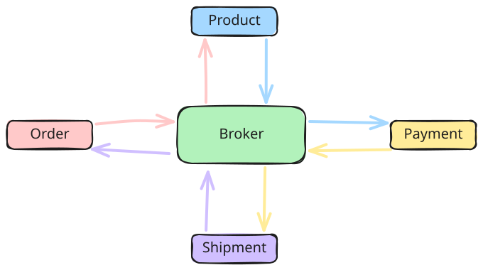
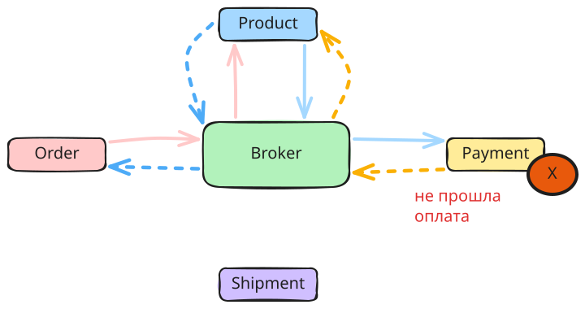

# Проблематика

- В микросервисной системе бизнес-процесс в большинстве случаев задействует множество микров. Например, процесс "Оформить заказ" может выглядеть так:

  ```
  Рассчитать стоимость -> Зарезервировать товар -> Принять оплату ->
  -> Сформировать тикет на сборку и отправку -> Отправить уведомление клиенту
  ```

  И каждый шаг может реализовываться отдельным микром. Соответственно, когда один микр свою часть сделал, начинает работать другой и т.д., пока все задействованные в процессе микры не отработают.

- Но в микросервисных системах обычно используется паттерн `Database per service`, т.е. у каждого микра своя собственная БД, не связанная с другими БД других микров. Соответственно, единой технической транзакции нет. Например, если вдруг оплата не пройдет, у нас нет возможности просто "откатить транзакцию", чтобы снять резев с товара.

- Это проблема - есть "логическая" транзакция (бизнес-процесс), которая состоит из множества независимых транзакций (локальные операции в БД каждого микра), и нужен способ отката этой "логической" транзакции, чтобы при ошибке на каком-то шаге система вернулась в корректное состояние (не было "зарезервированных вникуда" товаров в данном примере).

- Паттерн SAGA - является решением этой проблема.

# Идея паттерна

- Ключевая идея саги - это `компенсация`. Т.е. на каждое действие есть компенсирующее действие. Это может быть либо "обратное" действие (снять резерв с товара), либо иное действие, суть которого - вернуть систему в корректное состояние.
- Когда на каком-то шаге происходит ошибка, то для предшествующих шагов запускаются компенсирующие действия.
- При таком подходе получается, что целостности данных нет в моменте, но она есть *по итогу*.
  - Это называется `eventual consistency`, в противовес `strong consistency` при "классических" транзакциях, когда данные целостны в каждый момент.


# Техническая реализация

- Сага это концептуальный паттерн. Для его реализации не обязательно использовать события и очереди, хотя часто их как раз и используют.
- Для реализации можно пользоваться как `хореографией`, так и `оркестрацией`.


## Реализация через хореографию

- Подходит, когда сервисов не много и их взаимодействие легко осознать
- Суть в том что каждый микр сам должен знать, на какие события реагировать

### Успешный сценарий

- Все микры отработали без ошибок:



### Сценарий с ошибкой

- В микре оплаты что-то пошло не так, нужна компенсация:



- Компенсации показаны пунктиром
- Каждый микр сам решает, на какое компенсирующее событие реагировать. Например, Product реагирует на сообщение от Payment, делает компенсацию и тоже выпускает соответствующее событие, например "Резерв отменен". А Order например на событие "Не прошла оплата" не реагирует, но реагирует на "Резерв отменен". В общем, вся логика на что реагировать - при оркестрации ложится на плечи самих сервисов.

## Реализация через оркестрацию

- При оркестрации есть `оркестратор`, который координирует работу микров
  - Микрам уже не приходится думать, на какое событие реагировать
- При этом все сообщения делятся на
  - команды
  - ивенты
- самописный сервис
- готовые BPMN-решения (Buisness Process Model and Notation)
  - например, Camunda


# TODO

- Вопросы, которые предстоит рассмотреть:
  - идемпотентность, ретраи, порядок событий


# v.2

# SAGA

## О чем паттерн

- Об организации транзакции в распределенной системе.
  - Если у каждого сервиса своя БД, а бизнес-процесс распределен между сервисами, то как собрать все эти "разрозненные" локальные транзакции сервисов в единую транзакцию? Вот на этот вопрос и отвечает паттерн сага.


## Информация о паттерне

- Сага является альтернативой традиционным распределенным транзакциям
  - Одной из форм реализаций распределенной транзакции является X/Open Distributed Transaction Processing (DTP) Model (X/Open XA) с использованием двухфазного коммита (two-phase commit, 2PC)
  - Недостатки
    - Поддерживается почти всеми современным SQL-СУБД, но плохо поддерживается не-SQL СУБД, вроде MongoDb, а также не поддерживается очередями вроде Kafka.
    - По своей сути является синхронной, а это требует чтобы все участники транзакции были доступны. Соответственно, чем больше участников, тем больше шансов, что хотя бы один будет не доступен, а значит транзакция не завершится.
- Для каждого процесса, который затрагивает несколько сервисов, объявляется сага.
- Сага это последовательность локальных транзакций, которая координируется через асинхронный обмен сообщениями. Каждая локальная транзакция обновляет данные в пределах одного сервиса, используя старые-добрые ACID-транзакции.
- Какая-то системная операция инициирует первый шаг саги (например, в сервис приходит запрос). Когда локальная транзакция завершается, этот факт приводит к следующему шагу саги, выполняется другая локальная транзакция и т.д., пока все шаги саги успешно не выполнятся.
  - Использование асинхронных очередей позволяет саге завершиться, даже если в моменте не все участники доступны (за счет того, что выполнение не обрывается, а просто по сути приостанавливается до тех пор, пока лежащие участники не поднимутся).
- Саги нуждаются в изоляции (I из ACID) и реализации компенсирующих транзакций.
- Когда один сервис завершает свою локальную транзакцию, он публикует сообщение. Другой сервис получает это сообщение, выполняет свою локальную транзакцию и публикует свое сообщение и т.д. Если како-то получатель недоступен, то сообщение просто лежит в очереди до тех пор, пока получатель не поднимется (TODO: или, вероятно, до предусмотренного таймаута).
- Компенсирующие транзакции
  - Если какой-то шаг саги проваливается, тогда сага должна отменить эффекты всех предыдущих успешно завершенных шагов. Отмена происходит в обратном порядке, например `T1 > T2 > T3 > T4 failed > C3 > C2 > C1`. С - компенсирующие транзакции. Грубо говоря, если T3 зарезервировала товар, то C3 должна снять резерв.
    - TODO: тут еще можно было бы выяснить, каким образом выполняется это "снять резерв". Удалить строчку вряд ли, скорее всего статус поменять или вроде того.
- Логика саги ответственна за выполнение шагов процесса и за порядок компенсирующих транзакций.
- Координирование саг
  - Участники саги (сервисы) публикуют свои события и потребляют события других сервисов.
  - Обновление БД и публикация в очередь должны быть выполнены атомарно.
  - Сервис должен иметь возможность связать полученное сообщение с данными. Т.е. понимать, что вот это сообщение относится к такому-то заказу. Это делается через `correlation id`.
- Некоторые сервисы реагируют не на одно событие от других сервисов, а на комплекс. Например, сервис D должен получить события от сервисов A, B, C вместе чтобы выпустить свое. Например, получает событие от C и как бы спрашивает себя "а от A и B я уже получил события?". События могут приходить в разном порядке, не A-B-C, а C-A-B и т.д. и это не должно иметь значения. Т.е. у D как бы состояние саги присутствует.
- Саги на хореографии
  - Удивительным образом прочитал, но писать как будто и не о чем
- Саги на оркестрации
  - Оркестратор говорит участникам саги, что делать. Он посылает им команды, они асинхронно отвечают. Общение через брокер сообщений 
    - TODO: но как будто бы можно и просто асинхронно делать через gRPC например, нет? Допустим, в джаве виртуальный поток блокируется, это не проблема, и ждет пока сервис ответит.
  - Оркестратор можно выполнить в виде отдельного класса.
  - У Ричардсона на картинке стр 122 с демонстрацией саги интересно то, что для каждого сервиса есть отдельный топик в брокере, плюс есть один топик для самого оркестратора. Оркестратор шлет команды сервисам через их топики, а они отвечают ему отправкой сообщения в его топик.
  - Сагу можно делать как state-машину, потому что если описать все возможные состояния, то все становится нагляднее.
    - Машина состоит из состояний и переходов между состояниями. Переходы происходят при получении сообщения от участников саги.

### Lack of Isolation

- Изоляция (буква I в ACID) - это правило "если множество транзакций выполняются конкурентно, то результат должен быть такой же, как если бы они выполнялись последовательно".
- Аномалии - это ситуации, когда конкурентные транзакции видят данные не такими, какими они бы их видели, если бы выполнялись последовательно.
  - Виды аномалий
    - `Lost Updates` - когда одна сага переписывает результаты работы другой саги, не прочитав их.
      - Например, клиент оформляет заказ - запускается одна сага, заказ создается в статусе "Проверка". Пока сага выполняет проверку, клиент отменяет заказ - запускается другая сага, которая заказ отменяет. И тут первая сага дорабатывает, проверка завершается и заказ переходит в статус "Одобрен", хотя по сути он уже был отменен другой сагой.
    - Dirty Reads - когда одна сага читает и опирается на данные, которые в данный момент изменяет другая незавершенная сага.
      - Например, есть сага "Заказать" и "Отменить". Заказ списывает деньги, а отмена возвращает. Но отмена возможна только в течение какого-то времени, например, пока заказ не начали собирать. А если начали, то отменять уже нельзя. Допустим, у клиента 3000р, он сделал заказ на 3000 и отменил его. Запускается сага отмены, которая возвращает деньги, но как выяснится чуть позже, отменять уже нельзя и эта сага отменится. Пока эта сага не завершилась, клиент оформляет еще один заказ на 2000. Денег ему хватает из-за грязного чтения, и даже еще 1000 остается. Тут сага "отмены" наконец откатывается и у клиента оказывается 1000-3000=-2000р.
    - Fuzzy / Nonrepeatable Reads - вроде как редкая, не было в книге описания.
- Виды транзакций в саге
  - `Compensatable` (компенсируемая) - транзакции, для которых существуют компенсирующие транзакции.
  - `Pivot` (опорная) - "точка невозврата". Если эта транзакция проходит, тогда сага должна выполниться до конца. Это либо последняя компенсируемая транзакция, либо первая повторяемая. Либо как вариант, она может быть ни той, ни другой.
  - `Retriable` (повторяемая) - транзакции, которые обязаны быть выполнены. Надо траить их до успешного выполнения.
  - Они идут друг за другом - компенсируемые, потом "опорная", потом повторяемые. Например, "Создать заказ" - это компенсируемая транзакция, потому что в случае чего можно, грубо говоря, просто поменять статус на "Отменен" и все. "Оплатить заказ" - это поворотная транзакция. Как только бабки списаны, нужно довести сагу до конца.
    - TODO: а что мешает после списания отменить заказ другой сагой?


## TODO

- Саги это всегда самописка или есть готовые решения?
- А если шаг саги фейлится не по бизнесу, а технически, то делаются ретраи?
- compensatable transactions и pivot transaction
- Под каждый сервис в кафке делается отдельный топик?
- **stateful saga participant** — сервис хранит локальное состояние саги (это наверное про хореографию?)
- Что делать если какие-то события не дошли и сага "зависла"?
- In complex orchestrated transactions, a shared and persisted transaction state may be necessary, as well as a locking mechanism to prevent concurrent step activation