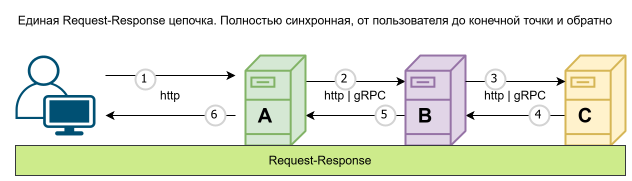
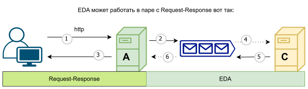
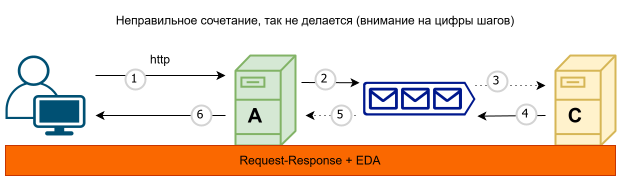

- Здесь напишу обзорно про все, в общих чертах. Подробнее в отдельных конспектах.

# ✅ Upstream и Downstream сервисы

- Терминология применяется в микросервисах.
- Например, бизнес-процесс вызывает сервисы в таком порядке "Заказы" > "Склад" > "Платежи" > "Доставка".
- Upstream и Downstream - это как движение по реке. "Вниз" по реке - это по течению, а "вверх" - это против.
- Соответственно если представить порядок вызовов сервисов как движение по реке, то для "Склада" сервис "Заказы" будет апстрим сервисом, а "Платежи" и "Доставка" - даунстрим сервисами.

# ✅ Хореография и оркестрация

- В микросервисах единый бизнес-процесс распределен между несколькими сервисами и поэтому между ними требуется обеспечить координацию.
  - Для этой координации есть два различных подхода - `Хореография` и `Оркестрация`.
    - Они могут быть как в чистом виде, а может быть гибрид.

## Оркестрация

- `Оркестрация` - это подход с централизованным управлением взаимодействием между сервисами.
- Есть компонент, называемый оркестратором, которому выделены такие обязанности:
  - Вызывать сервисы в нужном порядке, чтобы обеспечить выполнение бизнес-процесса.
  - Обрабатывать ошибки, обеспечивать повторные попытки и запасные действия. Например, какой-то сервис не отвечает, или не может выполнить свою функцию, или в нем возникает ошибка - во всех этих случаях решение о том, как на эти проблемы реагировать, принимает оркестратор.
- Оркестратор может быть реализован по-разному, например:
  - Как отдельный микросервис, на который возложена только функция оркестрации.
  - На один из существующих бизнес-сервисов может быть дополнительно возложена функция оркестрации, если она органично ему подходит.
  - Может быть отдельный готовый инструмент, специализирующийся на функции оркестрации. Это обычно называется BPMN-движки (Camunda например)
- Достоинства и недостатки
  - Достоинства
    - Поскольку реализация бизнес-процесса сконцентрирована в одном месте, она более наглядна, проще понять процесс. По этой же причине проще обрабатывать ошибки, делать ретраи.
  - Недостатки
    - TODO: недостатки я не понял, поэтому не пишу их сюда. По-моему недостатков нет, если применить в правильной ситуации.

## Хореография

- `Хореография` - это децентрализованный подход в организации взаимодействия сервисов и потока данных.
  - Это значит, что нет единого координатора, который знает весь бизнес-процесс и шлет сервисам команды для его выполнения. БП как бы размазан по сервисам, каждый сервис публикует свои события и знает, на какие события он должен реагировать.

## TODO

- А в топик идут разные типы событий? Если да, то сервисы получают все события и фильтруют типа "мое \ не мое"?
- Вообще  события делятся на "команды" и "просто события"? 
- Оркестрация \ хореография чаще реализуется через прямой вызов или через очереди? Под прямым вызовом я имею ввиду например через gRPC, даже если он асинхронный физически. Т.е. есть ли для О\Х наиболее характерный способ обмена?
- 

# ✅ SAGA

- Сага нужна для организации транзакции в распределенной системе.
  - В микросервисах у каждого сервиса своя собственная БД и бизнес-процесс почти всегда задействует несколько сервисов.
  - Например, бизнес-процесс "оформить заказ" условно можно разделить на шаги "Создать заказ" > "Зарезервировать товар" > "Взять оплату". Каждый шаг выполняется в отдельном сервисе, на отдельной БД. На этапе "Взять оплату" оказывается что денег у клиента недостаточно или система оплаты не отвечает после нескольких попыток. Стало быть, нам надо снять резерв с товаров и отменить заказ.
    - Т.е. по сути если какой-то сервис не может выполнить свою часть бизнес-процесса, нам нужно "откатить" уже успешно завершенные транзакции в других сервисах.
      - Паттерн сага решает эту задачу.
- Есть отдельный конспект, там подробнее

# ✅ EDA - Event Driven Architecture

- `Событийно-ориентированная архитектура` - это модель коммуникации сервисов, при которой один сервис не вызывает другой напрямую, посылая запрос, а вместо этого публикует события. Сервисы могут подписываться на интересующие их события и когда такое событие происходит, они его получают и что-то делают. Называется Pub / Sub.
  - Для публикации и доставки событий используются очереди сообщений, например Kafka. В сервисах достаточно подключить необходимые библиотеки для работы с очередью, и всю рутину по доставке событий от публикатора до подписчика берет на себя очередь. В сервисах только остается написать код, обрабатывающий данные из события.
- Такая архитектура позволяет
  - Развязать сервисы. Поскольку сервису не надо никого вызывать непосредственно, то легко добавлять новых подписчиков на события прозрачно для сервиса-"источника" этих событий.
  - Повысить устойчивость к сбоям. В случае синхронной работы, когда сервис А вызывает другой сервис Б и ждет ответ, то если Б лежит или тормозит, то А тоже начинает тормозить и тоже может лечь. В случае EDA сервис А просто накидывает сообщения в очередь, а Б обрабатывает их в своем темпе.
  - Давать моментальные ответы. Если бизнес-процесс длинный, включает в себя несколько шагов, то EDA позволяет не ждать, пока все шаги выполнятся, а отдавать ответ моментально. Например, ответить пользователю "Ваша заявка принята, за ходом выполнения следите в личном кабинете".
- Где EDA не подходит
  - Там где естественным образом нужна модель Request-Response, т.е. "мне, чтобы дальше работать, нужно спросить и получить ответ".
    - Например, запросить остатки товара на складе, актуальную цену, статус заказа, процент выкупа товара у клиента и т.д. В этом случае один сервис напрямую спрашивает у другого безо всяких очередей и событий.
    - Сюда же относится аутентификация / авторизация, платежи, т.е. когда ответ нужен "здесь и сейчас" и не допускает временного лага.
- Примеры
  - Проведение платежа
    - Я плачу за интернет, провайдер генерирует мне qr-код. Я его отсканировал, мой запрос пошел на сервер. Это Request-Response модель, синхронная концептуально. Дальше сервер тоже послал какие-то запросы к платежным системам, не важно куда. Важно что до "банка" эта цепочка запросов тянется по синхронной Request-Response модели, EDA тут пока нет. Когда банк проверил, что денег достаточно, он, условно говоря, их заморозил и дал ответ "Денег достаточно, все ок" и по синхронной цепочке ответ вернулся мне в браузер, он мне показал "Оплата прошла успешно" например. А вот все остальные дальнейшие внутренние операции уже идут через EDA. Условно, какой-то сервис выпускает событие "деньги заморожены под платеж", другой сервис на это событие реагирует, может быть выпускает свое событие, а может быть шлет кому-то тоже запрос по Request-Response модели и т.д.
      - Т.е. тут важно понимать, что модели Request-Response и Pub-Sub работают вместе, но технически не объединены - на запрос ответ синхронный, без подмешивания событий.

- Под эту картинку подходит пример "Платеж". На всем пути от пользователя до банка - синхронный Request-Response.

- Под эту картинку - пример "Ваш заказ принят, о ходе выполнения смотрите в личном кабинете". От пользователя до первого сервиса Request-Response, а между сервисами внутри системы - EDA с Pub-Sub.

- Неправильная комбинация.
  - Технически возможно, но это будет хак для реализации Request-Response модели поверх очередей. Может использоваться в околомаргинальных случаях.

## TODO

- EventBridge, SQS

# Eventual Consistency

- TODO

# Event sourcing

- TODO

# Webhooks

- TODO

# ✅ Outbox

- Этот паттерн нужен для атомарного выполнения двух действий: сохранение в БД + отправка сообщения в очередь.
- В микросервисах обычно бывает так: сервис что-то закоммитил в БД и должен отправить в очередь сообщение, чтобы сообщить об успешном выполнении.
- Типичная ситуация: успешно сохранили данные в БД, сервис лег и не успел отправить в очередь сообщение. Если сначала отправлять сообщение, а потом сохранять данные в БД, то сервис может лечь после отправки сообщения. В общем, от перестановки мест слагаемых проблема не изменяется, потому что эти действия независимые, а должны быть логически единым целым.
  - Паттерн outbox позволяет эту проблему решить.
- Есть готовые инструменты, вроде Debezium, которые мониторят WAL базы данных и когда видят, что добавились наблюдаемые данные, собирают сообщение и отправляют в очередь.

# ✅ Circuit Breaker

- Этот паттерн нужен для предотвращения каскадной деградации сервисов в случае падения одного из них.
- Базовый смысл в том, что когда один сервис ложится, то это разными способами приводит к тому что другие сервисы, которые к нему пытаются достучаться, начинают деградировать в производительности и могут тоже лечь.
  - Например, сервис А шлет запросы в сервис Б, который лежит. В сервисе А начинают копиться потоки, которые не получат ответ. Тут либо потоки закончатся, либо память исчерпается, в итоге А тоже может лечь. Если для общения используется очередь, то гипотетически сервис А может забить очередь сообщениями, которые сервис Б не забирает, потому что лежит, и тут может сдеградировать уже сама очередь и проблемы начнутся уже у всех сервисов, которые ею пользуются. В общем, конкретные причины, из-за которых все начинает валиться, можно разбирать отдельно.
- Задача Circuit Breaker (`"предохранитель"`) - понять, что сервис Б лежит, и перестать его дергать. Обычно предохранитель входит в состав самого сервиса А. Обычно это не самописка, а готовое решение, например для Java это Resilience4j.
  - Базовый принцип работы предохранителя
    - При обнаружении, что за последнюю, допустим, минуту, все запросы к Б провалились, перестать слать ему новые запросы, а сразу возвращать, например, ошибку (или заготовленную заглушку, или кэшированные данные, это обсуждаемо). Т.о. предохранитель "разрывает" цепь, связывающую сервисы. Это состояние предохранителя называется `open`.
      - Т.о. сервис А не тратит ресурсы на отправку запросов, которые все равно закончатся таймаутом. По сути, метод, в котором формируется и отправляется запрос, даже не вызывается.
    - Через какое-то заданное время предохранитель может перейти в состояние `half-open`, т.е. пропустить небольшое количество запросов от А к Б, чтобы проверить, не поднялся ли Б. Если эти запросы тоже провалились, значит Б еще лежит и предохранитель снова становится open. Если же выполнились успешно, предохранитель становится `closed`, "цепь соединяется" снова и запросы идут в штатном режиме.

# API Gateway

- точка входа в "зону микросервисов"
- принимает запрос от пользователя по http, проверяет авторизацию и принимает решение, в какой сервис отправить запрос
- т.о. служит для изоляции внешнего мира от системы, никому не известна за счет этого структура системы

# CAP-теорема

- `CAP`
  - consistency
  - availability
  - partition tolerance

# Access Token

- Технологии
  - keycloak
  - OAuth
- Запрос приходит на гейт, затем через сервис авторизации к нему пришивается токен с правами и дальше все запросы снабжаются этим токеном, так что сервисы, на которые запрос приходит, понимают права, доступные этому запросу

# CQRS

- TODO

# Service Discovery

- TODO

# 🤷 Прокси-сервер

- `Прокси-сервер` - промежуточная точка между источником запроса и конечным получателем.
  - TODO формулировка конечно дерьмовая, потому что что такое "точка"? роутер это тоже точка. А может промежуточный сервер какой-то быть, но не являться при этом проксей? Разобраться.
- `Reverse Proxy` - обратный прокси сервер. Используется, чтобы скрыть внутреннее устройство (подсети?) от внешнего мира.
  - Наивный пример: есть наш контур с микросервисами, перед ним ставим reverse proxy и все запросы идут на него. Т.о. тот, кто работает с нашей системой, не знает какие внутри нее крутятся сервера, какие у них адреса и т.д., он знает только адрес reverse proxy.
- TODO
  - Может ли конечный сайт понимать, что ему запрос пришел от прокси?
    - Да, может.

# Load Balancer

## Вопросы

- Балансировщик вероятно ставится перед каждым сервисом системы?
- Балансировщик может как-то защищать от DDoS атак?
- Алгоритмы балансировки.
- Sticky Sessions.
- Обратные прокси-серверы.

# Rate Limiter

- TODO

# TLS

- TODO

# DLQ - Dead Letter Queue

- TODO

# SOAP

- TODO

- 

# TODO

- Ретраи и дедупликация сообщений

- Eventual Consistency

- Latency

- CorrelationId

- Разделение фронта и бэка на разные сервера

  ---

- Database per serivce

- API Gateway

- Client-side discovery

- Server-side discovery

- Circuit breaker

- Access Token

- Event Driven

- Event Sourcing

- SAGA

- CQRS

- Outbox

## Ключевые архитектурные темы

➖ **Domain-Driven Design (DDD)**
Проектируем систему вокруг бизнес-домена, а не вокруг таблиц.

➖ **Event-Driven Design**
Строим слабосвязанные системы, реагирующие на события.

➖ **Проектирование отказоустойчивости**
Circuit Breaker, Retry, Bulkhead — не просто теория, а практическая реализация.

➖ **Распределённые транзакции**
Saga Pattern, Outbox, гарантии доставки (At-Least-Once / Exactly-Once).

➖ **CQRS и Event Sourcing**
Проектирование систем, готовых к высокой нагрузке.

➖ **API Gateway и Service Discovery**
Реальная архитектура микросервисной среды.

➖ **Мониторинг и наблюдаемость**
Prometheus, Grafana, Loki — видимость системы в продакшене.

🏗 **Какие паттерны вы реально реализуете**

— Idempotency Key
— Circuit Breaker
— Retry Pattern
— Rate Limiter
— Bulkhead Pattern 
— Outbox Pattern
— Saga
— CQRS
— Event Sourcing
— API Composition
— Strangler Pattern
— API Gateway
— Service Discovery
— Load Balancing
— Access Token Pattern
— Database per Service

🛠 **Технологический стек 2026 года**

🔹Java
🔹Spring Boot
🔹Feign
🔹Wiremock
🔹Resilience4j
🔹Apache Kafka
🔹RabbitMQ
🔹Spring Cloud
🔹Eureka Server
🔹Netflix Zuul
🔹Maven
🔹GitHub
🔹KeyCloak
🔹Postgres
🔹MongoDB
🔹Grafana
🔹Loki
🔹Prometheus
🔹Promtail
🔹Grafana K6
🔹Docker
🔹Kubernetes