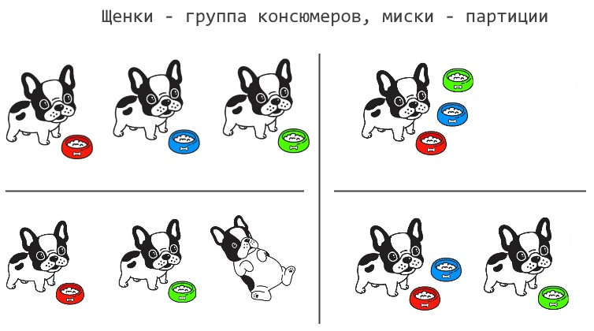
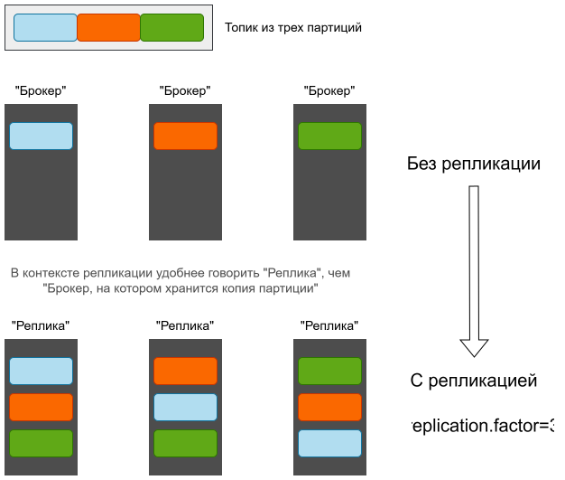
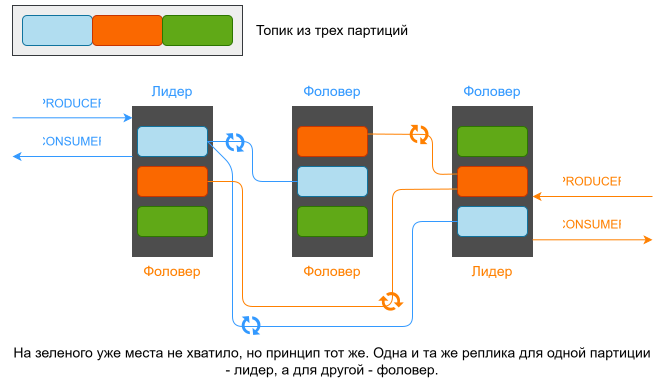

# Kafka - распределенная система

## Узлы

- Кафка - это распределенная система, т.е. можно взять несколько серверов, запустить на каждом кафку и объединить их в кластер.
  - Т.о. получить отказоустойчивость и горизонтальную масштабируемость.
  - В проде имеет смысл выделять под каждый экземпляр кафки отдельный сервер. Нет смысла на одном сервере запускать несколько экземпляров, например на разных виртуальных машинах. Потому что, во-первых, они будут конкурировать за ресурсы, значит никакой масштабируемости. А во-вторых, если сервер ляжет, то лягут и оба экземпляра. Значит, никакой отказоустойчивости.
    - "Несколько кафок" на одном сервере имеет смысл только в учебных целях локально, чтобы тренироваться настраивать кластер.
- Кафка представляет собой один процесс в ОС (но в нем много потоков под разные цели).
- Сервер, на котором работает кафка, называется `узел`.

## Роли узла

- Кафка - это один процесс, который в зависимости от настроек может выполнять две роли:
  - `Контроллер ` - это узел, который берет на себя менеджерские обязанности.
    - Например, выбор нового лидера партиции при падении текущего лидера.
  - `Брокер` - узел, которых хранит данные топиков. 
- Технически узел может совмещать две роли, но на практике принято разделять роли по разным узлам, чтобы управление и хранение не перемешивалось.

## Прозводительность

- При создании топика кафка старается размазать его партиции равномерно по всем брокерам кластера.
  - Например, в топике 4 партиции и есть 4 брокера - идеальный случай, будет по одной партиции на брокере.
  - Если будет 4 партиции и 3 брокера, значит на каком-то брокере будет 2 партиции.
  - Поэтому рекомендуется делать количество партиций кратным количеству брокеров, чтобы размазывание происходило равномерно: 3 брокера - 3 \ 6 \ 9 партиций, 4 брокера - 4 \ 8 \ 16 партиций и т.д.
    - Это не жесткое требование, но хорошая практика.

## Метаданные

- `Метаданные` - это полная информация о кластере - сколько в нем брокеров, их адреса, сколько топиков, партиций, где они лежат, кто для них лидер и т.д.
- Метаданные хранятся на всех узлах и автоматически обновляются по мере появления изменений.
  - Однако "источником истины" метаданных являются контроллеры.
- Клиент может подключиться к любому из брокеров, получить метаданные и по ним понять, к какому именно брокеру ему надо обращаться для непосредственной работы с топиком.
- Клиент перезапрашивает метаданные сам.
  - По таймеру (автоматически каждые 5 минут).
  - При появлении ошибок при работе с брокером.

# Организация данных

## Топик и партиции

- `Топик` - делит хранимые данные по смыслу ("логическое" деление)
  - Например
    - Трекинг система действий пользователя.
      - В одном топике - клики, скроллы, переходы по страницам и т.д.
      - В другом топике - когда зашел, когда вышел.
      - В третьем - кого добавил в друзья, кого удалил.
    - Система оформления заказов.
      - По топику на заказы, платежи, уведовления.
  - Благодаря этому системы могут потреблять только нужные им данные, а не все подряд.
- `Партиции` - это физическое хранение топика.
  - Один топик можно делить на несколько партиций.
    - Это нужно для масштабируемости чтения и записи - сколько партиций, столько и консюмеров / продюсеров смогут параллельно читать / писать топик.
    - Разумное практическое количество партиций на топик это 6-30. Но технически можно сделать даже несколько тысяч партиций на один топик. Расчет оптимального количества партиций - отдельная тема.

## Сообщения

- Данные в кафке хранятся в виде `сообщений`, т.е. сообщение - это единица хранения информации
  - Еще называют запись \ record
- Состав сообщения
  - Ключ - используется для определения, в какую партицию положить сообщение
  - Значение - полезная нагрузка сообщения
  - Заголовки - дополнительная метаинформация
  - Таймштамп - время создания сообщения

## Продюсеры и консюмеры

- `Продюсеры` - пишут сообщения в брокер (кафку)
- `Консюмеры` - читают сообщения из брокера

## Способ хранения данных

- Кафка хранит данные в файлах на диске
- В оперативке хранится кэш
  - Т.е. сперва идет чтение из оперативки и если там нужных данных нет, тогда читается с диска и помещается в кэш
- Партиция - это папка, а внутри нее лежат файлы - `сегменты`
  - Это сделано чтобы старые данные можно было удобно удалять и при записи не приходилось работать с гигантским единым файлом
- Одна партиция хранится целиком на одном брокере
  - Т.е. данные одной партиции не размазаны по нескольким брокерам, а хранятся в одном месте
  - Но разные партиции могут храниться на разных брокерах, даже если принадлежат одному топику
    - Т.о. образом растет скорость работы с топиком за счет параллельной работы с партициями

# Запись данных

## Как определяется партиция

- Ключ сообщения проходит через хэш-функцию и на основе этого определяется партиция, в которую попадет сообщение
  - Так что сообщения с одним ключом гарантированно окажутся в одной партиции
  - Партиция работает по приципу FIFO, новые данные записываются в конец очереди, а чтение идет с начала
  - В качестве ключа надо выбрать такое значение, которое сгруппирует связанные данные, когда это нужно и важен порядок. Очередь уже гарантирует нам соблюдение порядка, нам остается выбрать ключ, чтобы все связанные сообщения попадали в одну партицию
    - Например, берем ключ vehicle_id. Автомобиль передает координаты своего движения, они попадают в брокер, в одну и ту же партицию. Порядок соблюден - так что какой-нибудь сервис может читать эти координаты и делать вычисления, рисовать маршрут на карте и т.д.
- Если ключ не задан, то кафка старается распределить данные равномерно по партициям.
  - Это достигается разными стратегиями, например
    - round-robin
    - sticky partitioning
  - Такое поведение полезно в ситуациях, когда для консюмера не критичен порядок получения сообщений и он может его восстановить сам по данным из нагрузки.
    - Например, метрики с датчика. Если у них есть временная метка, можно просто сохранять их себе в БД и строить графики на основе этой метки, а не порядке в очереди. Порядок в очереди важен например в транзакциях, командах микросервисов.

## Семантика доставки

- Семантика доставки - это гарантии доставки сообщений, которые кафка дает продюсеру
- Три логических вида
  - `at-most-once` - "максимум один".
    - Быстро и ненадежно. Просто отправил и все. Если сообщение не дошло, значит не повезло, оно не попадет в очередь.
  - `at-least-once` - "минимум один"
    - Надежно, но возможны дубли. Брокер отправляет продюсеру подтверждение сохранения. Если подтверждение потерялось по дороге, продюсер пошлет еще одно сообщение, которое брокер воспримет как новое. Получится дубль.
  - `exactly-once` - "точно один"
    - Самое медленное, но самое точное. Гарантия доставки и гарантия, что не будет дублей.
- Технически можно достигнуть этих семантик разными комбинациями опций отправки, но логически возможны все равно только три этих варианта.
- Реализация этих сценариев делается через настройку параметров топика `min.insync.replicas`, `replication.factor` и параметра `acks` продюсера. Об этих параметрах рассказано в разделе про отказоустойчивость.

| Режим           | replication.factor                                           | min.insync.replicas | acks  | Дополнительно                                                |
| --------------- | :----------------------------------------------------------- | ------------------- | ----- | ------------------------------------------------------------ |
| `at-most-once`  | ❌                                                            | ❌                   | `0`   |                                                              |
| `at-least-once` | Зависит от min.insync.replicas. Если там 2, то тут соответственно тоже `>=2` | `>= 2`              | `all` |                                                              |
| `exactly-once`  |                                                              | `>= 2`              | `all` | Для продюсера надо включить настройку `enable.idempotence=true` |

- При идемпотентной отправке продюсер отправляет лидеру свой ID и ID сообщения. Лидер благодаря этому может понять, что
  - Сообщения пришли в неправильном порядке. Например сообщение #1 еще идет, а #2 уже пришло. Тогда лидер отправляет продюсеру NACK - "отрицательное подтверждение" и тот отправляет сообщение повторно. К этому времени сообщение #1 например успевает прийти, лидер видит правильный порядок и посылает подтверждение ACK.
  - Одно и то же сообщение пришло дважды. Тогда лидер просто посылает подтверждение, а дубль сообщения не записывает на диск.
- Идемпотентная отправка по умолчанию включена с версии Kafka 3.0

## Особенности записи

## Батчи

- Продюсер отправляет сообщения не по одному, а пачками (`batch`)
  - Это дает меньше сетевых вызовов.
- "Отправить пачку" фактически означает лишь поместить ее в очередь отправки, а когда она реально уйдет по сети - не продюсерская забора.
- Есть два параметра пачек
  - `batch.size` - размер пачки (по умолчанию 16кб)
  - `linger.ms` (по умолчанию 0) - время, через которое надо точно отправить пачку, независимо от степени ее заполненности.
- Как это связано?
  - Допустим ставим linger.ms 10
    - Тогда продюсер будет накидывать сообщения в пачку либо пока она не заполнится полностью, либо пока не истечет это время.
    - Заполнилась или вышло время - пачка отправляется как есть в очередь на отправку. При низкой нагрузке это означает, что пачка из одного сообщения не будет ждать вечно своего наполнения.
  - Если linger.ms 0, то это означает не ждать наполнения пачки совсем, а отправлять ее сразу как поступило сообщение. Поэтому в теории это будут пачки из одного сообщения. Но на практике при высоких нагрузках даже при 0 в пачках может оказываться несколько сообщений.

## Компрессия сообщений

- По умолчанию сообщения не сжимаются
- За компрессию отвечает параметр `compression.type` у продюсера
  - Там есть несколько вариантов gzip, snappy, lz4, zstd, отличаются скоростью работы и степенью сжатия
- При включенной компрессии продюсер сжимает пачку, она уходит в брокер в сжатом виде и в сжатом же виде попадает консюмеру и он сам ее распаковывает

# Чтение данных

## Консюмер

- Чтением данных из топика занимаются консюмеры.
- Чтение происходит пачками, например консюмер читает сразу 100 сообщений и кладет себе в память.
  - TODO: Это каждый консюмер группы читает 100 сообщений из своей партиции?
- Прочитанные сообщения не удаляются из кафки из-за самого факта чтения, они хранятся столько времени, сколько потребуется.
- Один консюмер можно воспринимать как одного логического потребителя данных, например, приложение.
- Несколько приложений - несколько разных консюмеров.
- Один консюмер может читать несколько топиков.
- Консюмер может подписаться на чтение топика, тогда партиция для него назначится автоматически.
  - Но также есть возможность явно указать, из какой партиции читать. При этом если консюмер ляжет, другие консюмеры не смогут подхватить партицию за него.

## Группа консюмеров

- Для ускорения чтения приложение может использовать несколько консюмеров, при этом как бы логически они считаются одним консюмером.
- Это называется `consumer group` - группа консюмеров.
- Технически, даже если консюмер только один, он все равно оформлен как группа.
- Особенности организации группы консюмеров.
  - Один консюмер из группы может читать одну или несколько партиций.
  - Разные консюмеры из группы не могут читать одну и ту же партицию.
    - Это потому что группа консюмеров считается единым логическим консюмером. Значит если два из них будут читать одну и ту же партицию, получится что группа обрабатывает одни и те же сообщения дважды.
  - Если один из консюмеров ляжет, то другой возьмет на себя его работу.
  - Например, в топике 3 партиции
    - Идеальный вариант - одинаковое количество консюмеров и партиций, получается каждому по одной. Максимальная производительность чтения.
    - Если только один консюмер - он читает по кругу из всех 3 партиций ("один щенок может есть по очереди из всех трех мисок").
    - Если два консюмера - один читает например 1 и 2 партицию, а другой третью.
    - Если 4 консюмера - то 3 консюмера будут читать, каждый по одной партиции, а еще один консюмер будет простаивать ("два щенка не могут есть из одной миски")
      - Яркая ассоциация для запоминания принципа: у бульдогов большая морда, которая полностью закрывает миску, когда он ест. Поэтому другой щенок не может есть из той же миски.

## Офсет

- `Offset` - это позиция в партиции, до которой дочитал консюмер.
- Офсет позволяет консюмеру не терять положение чтения.
- Офсет характеризуется тремя вещами:
  - id группы консюмеров
  - партицией
  - номером сообщения
- Офсет хранится в памяти консюмера и пока консюмер работает, он знает позицию чтения.
  - Если консюмер падает, тогда офсет конечно же теряется, поэтому его надо периодически коммитить.

## Коммит офсета

- Коммит можно настроить либо `автоматический`, либо делать `вручную`
  - Это несовместимые способы - мы либо делаем вручную, либо автоматически, но не и то и другое вместе.
  - Автоматический коммит срабатывает по таймеру.
  - Автокоммит обычно используется для сценариев, где потеря чтений некритична (логи, метрики)
  - Для бизнес-сценариев обычно используется ручной коммит из-за большей предсказуемости и контроля.

## Порядок сообщений при чтении

- Порядок сообщений соблюдается только в пределах партиции.
- Если консюмер читает несколько партиций, то сообщения из них идут вперемешку.
- Аналогично если консюмер читает из нескольких топиков, то их сообщения тоже идут вперемешку.

# Очистка данных

- Политика очистки данных (`cleanup.policy`)
  - Удаление (`delete`)
    - По двум триггерам
      - Партиция превысила указанный размер - если суммарный размер сегментов партиции превысил заданный размер, то кафка удаляет старые сегменты
        - Они будут удаляться, пока размер партиции снова не станет меньше, чем задано
      - Сегмент стал очень старый (по умолчанию 7 дней) - если сегмент хранится дольше указанного времени, он удаляется
  - Сжатие (`compact`)
    - Из неактивных сегментов удаляются все значения для каждого ключа, кроме последнего
      - Например, есть `id123: active`, `id123: processing`, `id123: disabled` а после компакта останется только `id123: disabled`
    - Для нахождения сегментов, которые готовы к сжатию, используется отдельный фоновый процесс
- Для каждой политики есть свои настройки, которые можно загуглить когда потребуется выполнять настройку

# Отказоустойчивость

- **Репликация**, **Синхронизация**, **Подтверждение** - три столпа отказоустойчивости в кафке.

## Репликация

### Фактор репликации и реплики

- Репликация значит, что партиция будет храниться не в одном экземпляре, а у нее будет несколько **копий** и эти копии будут храниться на разных брокерах. Так что если брокер ляжет, то партиция будет доступна за счет наличия копии на другом брокере.
- Количество копий задается параметром `replication.factor` - фактор репликации.
  - Этот параметр относится к топику. Разным топикам можно задать разный фактор репликации.
    - Это делается при создании топика. Потом изменить можно, но сложно, поэтому лучше сразу продумать какое значение нужно.
  - Например, если фактор 2, значит партиция будет размножена на два брокера, если 3 - значит на три и т.д.
  - Фактор репликации не может быть больше количества брокеров.
    - Например, если брокеров 4, то фактор может быть 2 или 3, но не 5, потому что пятую копию придется класть в брокер, на котором уже лежит такая же копия. А хранить две копии на одном брокере бессмысленно.
- Стандартный фактор репликации - 3, хватает для большинства сценариев. 5 - максимальное практическое значение, при очень высоких требованиях к отказоустойчивости. Чем больше, тем по сути больше места жрут реплики и больше трафика для синхронизации.
- `Репликами` называют **брокеров**, на которых хранятся копии партиции.

### Лидер и фоловеры

- Понятие лидер и фоловер привязано к партиции в контексте репликации.
- Допустим, фактор репликации 3, значит будет три реплики.
  - Кафка назначит одну реплику лидером партиции (`leader`), в нее будет происходить чтение / запись партиции. Именно с лидером будут непосредственно работать продюсеры и консюмеры.
  - Еще двух реплик кафка сделает фоловерами (`follower`). Их задача - регулярно синхронизироваться с лидером, чтобы иметь на себе актуальную копию партиции на случай если лидер упадет.
  - Итого 3 реплики = 1 лидер + 2 фоловера.
  - Если лидер упадет, тогда кафка выберет нового лидера из фоловеров.
- Один и тот же брокер выполняет две роли
  - Для одной партиции топика он является лидером.
  - А для другой партиции этого же топика - фоловером.

- По картинке становится очевидно, что при репликации получается так, что топик целиком хранится на трех брокерах. Так что если один ляжет, будет еще две копии.

## Синхронизация, ISR

- Между лидером и фоловерами проходит синхронизация, чтобы копии партиций везде были в актуальном состоянии.
- Настройки брокера, связанные с синхронизацией
  - `replica.fetch.wait.max.ms` (500 мс дефолт) - фоловер непрерывно отправляет лидеру запросы синхронизации. Если у лидера в этот момент мало "новой" информации для фоловера (а "мало" или "достаточно" определяется настройкой *replica.fetch.min.bytes*, 1 байт дефолт), то лидер ждет эти самые 500 мс. Если за них успеет набраться 1 байт, он сразу их отправляет. Если же 500 мс проходит, то отправляется данных столько, сколько есть. Т.е. принцип похож на то как продюсеры отправляют данные - отправляем либо когда набрался нужный объем, либо когда истекло время. 
    - Т.о. настройка отвечает за длительность этого окна ожидания на лидере. Когда фоловер получил ответ с данные, он записывает их себе на диск и шлет следующий запрос синхронизации. И так по кругу.
  - `replica.fetch.min.bytes` (1 байт дефолт) - количество "новых" байт, при котором лидер не дожидается истечения *replica.fetch.wait.max.ms*, а сразу отправляет данные.
  - `replica.lag.time.max.ms` (30 сек дефолт) - если в течение этого времени фоловер а) не слал запросы синхронизации б) не успел "догнать" лидера по данным, то лидер считает этого фоловера отставшим, "протухшим" и исключает из ISR.
- `ISR` - In-Sync Replicas - это список **синхронизированных реплик**, т.е. реплик с актуальными копиями партиции.
- Список ISR ведет лидер
  - Список также передается в контроллер кластера, на случай если лидер упадет.
  - Сам лидер всегда входит в этот список, потому что очевидно что он всегда актуален.

## Подтверждение, acks

- `acks` - producer acknowledgements, это параметр продюсера.
  - Он задает, надо ли продюсеру подтверждение от брокера об успешной записи.
  - Значения
    - `acks=0` - продюсеру не надо подтверждения от брокера вообще. Он просто отправляет сообщение и считает его успешно отправленным.
      - Быстро и ненадежно.
    - `acks=1` - продюсеру надо подтверждение только от лидера.
      - Средняя скорость и средняя надежность.
    - `acks=all` - продюсеру надо подтверждение от всех реплик из ISR.
      - Низкая скорость, максимальная надежность.
- Параметр `min.insync.replicas` относится к **топику**
  - Он задает, сколько минимум синхронизированных реплик должно быть (ISR), чтобы лидер выполнил запись. Если реплик не достаточно, лидер возвращает продюсеру ошибку **NotEnoughReplicasException**.
  - Лидер берет в расчет этот параметр, только если продюсер требует подтверждения записи.

## Как это работает вместе в итоге

- В итоге стратегию надежности можно настраивать через три основных параметра

| Параметр              | К чему относится | Что значит                                                   | Рекомендовано для прода |
| --------------------- | ---------------- | ------------------------------------------------------------ | ----------------------- |
| `replication.factor`  | К топику         | Количество копий партиции                                    | `3`                     |
| `min.insync.replicas` | К топику         | Сколько должно быть реплик в ISR, чтобы лидер выполнил запись, если продюсер требует подтверждения записи | `2`                     |
| `acks`                | К продюсеру      | Нужно ли продюсеру подтверждение от брокера об успешной записи | `all`                   |

- Как это будет работать на примере значений из таблицы
  - *replication.factor=3* значит что партиция будет реплицироваться на 3 брокера (лидер + 2 фоловера), и в ISR будет 3 брокера (в случае если все они живы).
  - *acks=all* и *min.insync.replicas=2*
    - Продюсер отправляет сообщение лидеру. Т.к. *acks=all*, продюсер требует подтверждения. Лидер смотрит *min.insync.replicas* и сколько у него сейчас в ISR реплик. Допустим, один упал, осталось два (сам лидер + 1 фоловер). Т.к. *min.insync.replicas* задано 2, то падение одного фоловера допускается. Поэтому лидер записывает сообщение себе в партицию, фоловеры синхронизируются с лидером и когда это произошло, лидер отправляет продюсеру ответ - "сообщение записано успешно".
    - Теперь предположим, что продюсер шлет другое сообщение. В этот раз упало 2 фоловера. Лидер видит, что в списке ISR только одна реплика (фактически, только он сам). Это меньше чем *min.insync.replica*, поэтому он возвращает продюсеру ошибку NotEnoughReplicasException. Т.о. запись не произошла.

# Ребалансировка

- Ребалансировка бывает двух видов
  - Ребалансировка партиций между брокерами (`partition reassignment`)
    - Происходит, когда в кластер добавляется новый брокер, т.к. нужно провести перераспределение партиций между брокерами
    - Кафка автоматически этого не делает, надо запускать самостоятельно или настраивать автозапуск, иначе добавленный брокер будет просто простаивать
    - Особенности
      - Чтение из партиций не останавливается
  - Ребалансировка консюмеров (`consumer rebalance`)
    - Происходит, когда 
      - В группе консюмеров добавляется \ удаляется консюмер (добавили нового или упал один из работающих)
      - Когда консюмер подписывается на дополнительный топик
    - Кафка выполняет эту ребалансировку автоматически
    - Особенности
      - Чтение на время этой ребалансировки останавливается - никто из группы ничего не читает

# Работа с ошибками

## Dead Letter Queue

- `DLQ` - это паттерн, при котором сообщение, которое не удалось обработать, мы отправляем в специальный топик
  - Для обработки таких топиков делаем отдельных консюмеров

# 🧑‍🍳 Практические сценарии использования

## В каких случаях выбирать кафку?

- Как решить, что для коммуникации нужна именно кафка, а не например gRPC или REST?

## По какому принципу создают топики?

В крупных системах можно выделить две основные стратегии:

- **Один топик на доменную сущность (агрегат)**: все события, связанные с одной сущностью (например, `OrderCreated`, `OrderPaid`, `OrderCancelled`), отправляются в один топик, например, `order-events`. Это гарантирует строгий порядок обработки событий для одного заказа, так как они попадают в одну партицию.
- **Один топик на тип события**: для каждого типа события создается отдельный топик (`order-created`, `order-paid`). Это упрощает логику консьюмера, так как каждый подписывается только на  нужные ему события, но усложняет гарантию порядка для связанных событий.

Выбор зависит от приоритетов: если критичен порядок событий в рамках одного  агрегата — выбирают подход с одним топиком на сущность. Если важнее  простота и независимость консьюмеров — предпочитают топик на тип  события.

# TODO

- Больше про формат сообщений, про ключ, нагрузку, таймштамп, когда ключ задается. А то я смотрю на JSON, его поля и думаю, это блять что такое? Это нагрузка или прямо "часть сообщения кафки"?
- Как ключ влияет на партицию? Как-то сам указываешь что куда класть или кафка сама делает?
- Разобраться в способах увеличения пропускной способности. Например, как влияет отказ от ключа и выбор sticky partitioning на продюсера.
- Увидел про какую-то механику "в один топик сервис кладет запрос, а через другой топик ждет" ответ. При этом может быть проблема что если ответа нет, он начинает слать повторно запросы и засирать т.о. топик. Что это за сценарий работы и зачем он нужен?
  - Как будто бы это скам. Такая канитель вроде как реализуется разными обертками вроде Kafka Rpc, которые по сути реализуют request-responce модель, используя кафку как транспорт. Там создается "временный" топик, через который между сервисами происходит обмен, а после обмена топик дропается. В общем можно об этом отдельно почитать, но вероятно это что-то узкоспециализированное и не относится к классическому использованию кафки.
- "Горячие партиции"

## bytebytego

- Почему кафка?
  - Развязать сервисы (ну это вроде ясно)
  - absorbs traffic spikes - что такое "трафик спайкс"?
  - replay for debugging and recovery при ошибках
  - "топик для платежей, топик для user clicks, топик для video uploads" - это надо отдельно разбирать, стратегии оргранизации топиков.
  - заголовки - в примере там был corelation_id. Опять же, это правильное место для него? Или он дб в нагрузке?
  - брокеры обычно упираются в сетевые лимиты, нежели в CPU или диск.
  - неправильный выбор ключа приводит к появлению "горячих партиций", когда одна партиция нагружается, а остальные простаивают.
    - TODO: а как так получается? как ключ может привести к горячим партициям?
      - Приведен пример с "выходом блокбастера" и трансляцией его разными пользователями. Типа если ключ - это id фильма, тогда все щемится в одну партицию. А если сделать составной ключ, типа "хэш от фильм id и user id", тогда все четко. Подробнее почитать.
    - "time-based partition"
      - хорошо для логов
      - плохо для real time data (что такое рилтайм данные?)
  - надежность
    - лидер партиции, репликации
      - стандартная штука - три реплики
  - event sourcing через кафку
  - кафка оптимизирует throughput, но не latency (уточнить эти термины вообще сами по себе)