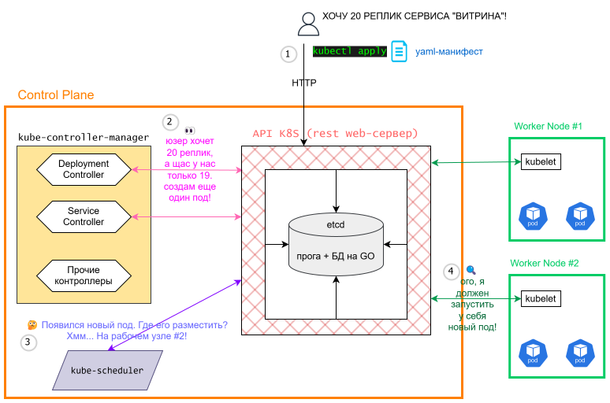
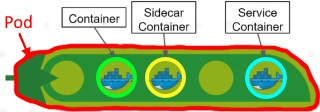

- Этот файл задумывался как единое место, в котором можно в целом разобраться как работает кубер, какие в нем есть понятия и как они связаны.
  - Здесь больше теоретическая часть, нацеленная на формирование общей картины.
  - При этом конечно по каждому объекту есть много настроек, про которые буду писать в отдельных файлах. Будет отдельный файл про Deployment, Service и т.д., которые буду постепенно заполнять по мере получения навыков и знаний.
- Могут быть какие-то технические огрехи и заблуждения, но я не ставлю цель описать все с хирургической точностью. Пишу до такой степени, чтобы можно было думать о теме. Постепенно буду косяки исправлять, если они будут всплывать.


# Что такое kubernetes

- `Кубер` - это оркестратор контейнеров.
  - P.S. "тачка" - это компьютер \ виртуальная машина.
  - Докер работает в пределах отдельной тачки, может крутить на ней контейнер или несколько. Но не может, например, как-то объединить несколько тачек.
  - А вот с помощью кубера мы можем как раз объединить несколько тачек с контейнерами в единый кластер и управлять ими централизовано. Например, подключить еще одну тачку, запустить на ней контейнер с сервисом и получить т.о. горизонтальное масштабирование сервиса.
- Кубер не привязан к докеру, может использовать и другие системы контейнеризации.
  - Нынче используется `containerd`


# kubectl

- `kubectl` (Kubernetes ConTroL / ex "Cluster TooL") - это консольная утилита для управления кластером кубера.
- Через kubectl доступен самый полный набор команд для управления кубером.


# Архитектура кубера




## Узлы (Node)

- `Node` (узел) - это отдельная виртуальная или физическая машина. Несколько узлов образуют кластер.
- Разновидности узлов
  - `Control-plane` - узел-"менеджер". Занимается управлением кластера, например, решает на каком узле запустить новый под.
  - `Worker-node` - узел-"работяга". На воркерах крутятся поды.
- Один и тот же узел технически может совмещать функции менеджера и воркера. Это подходит для тестовых и учебных целей, но в проде эти роли надо разделять по разным узлам.
  - На менеджерских и рабочих узлах выполняются разные процессы. Например, на менеджерах выполняется `kube-controller-manager`, `kube-scheduler`, а на рабочих - `kubelet`, `kube-proxy`. За счет такого деления тачка не грузится лишними процессами.
- В проде обычно делают несколько менеджерских узлов для отказоустойчивости. Причем их количество должно быть нечетным (но это уже отдельная история, про кворумы).


## Worker-узел

- На воркере работает три ключевых процесса:
  - `Container Runtime` (движок контейнеров) - за счет него на узле могут крутиться контейнеры.
  - `kube-proxy` - сетевой агент, который отвечает за управление сетевым трафиком внутри этого узла. Отвечает за то, чтобы запрос дошел до нужного пода.
  - `kubelet` - мониторит БД кубера на предмет того, а не появился ли, например, новый под, который требуется запустить на этом узле.


## API Kubernetes, etcd, контроллеры, scheduler

### API Kubernetes, etcd

- Ядро кубера - логически это REST веб-сервер (`API Kubernetes`) + БД (`etcd`)
- Когда мы описываем через yaml какой-то объект кубера и "пушим" его в кластер (через kubectl apply например), то по сути мы таким образом отправляем HTTP-запрос на api kubernetes.
  - Он валидирует этот yaml и если все в порядке, то создает в etcd (БД кубера) этот объект (или изменяет состояние существующего, если он уже создан).
  - Например, мы описали в yaml Deployment, в котором указали "хочу такой-то контейнер запустить в 3х экземплярах" и запушили.


### Контроллеры, желаемое и реальное состояние

- Для каждого типа объектов есть свой контроллер, который мониторит БД на предмет изменения или появления новых объектов нужного типа.
  - Все контроллеры являются частью процесса kube-controller-manager, и работают в отдельных потоках.
- Например, для объектов deployment есть Deployment Controller.
  - Продолжая пример - контроллер деплоев сравнивает описание объекта, которое мы запушили, с реальным состоянием кластера. Видит, что мы хотели 3 реплики контейнера, а сейчас работают только 2.
  - Тогда он создает в БД недостающие объекты, например поды (вообще там может быть более хитрая схема, когда контроллер создает какой-то объект, на него реагирует другой контроллер и т.д., это не особо важно, как это на самом деле работает).
  - Далее в работу включается планировщик (`scheduler`). Он вычисляет для размещения пода оптимальный узел и создает binding между подом и узлом.
  - На узлах работают kubelet'ы, которые тоже мониторят БД. Когда kubelet видит, что появился под, связанный с его узлом, то он поднимает этот под на своем узле.


# Основные понятия

- Здесь в основном перечислены объекты кубера. Они не имеют "физического" представления в ОС, это просто записи в etcd, по которым кубер ориентируется, что ему делать с кластером.


## Pod

- `Pod` - минимальная единица развертывания в кубере.
- Под не является процессом и физически как что-то самостоятельное не существует в ОС, это чисто логическое объединение процессов-контейнеров в единую группу.
- Под при запуске получает собственный ip-адрес, который может меняться от запуска к запуску, т.е. является нестабильным.
- Если под завершается, то завершаются и все процессы в нем.
- Поды как правило мы не запускаем непосредственно, а делаем это с помощью других объектов кубера, например deployment
  - Потому что обычно нужно чтобы за подом следили. Например, если он упадет, надо его перезапустить. Поскольку сам по себе под такого не умеет, нам и нужны вспомогательные объекты.
- На под можно навешивать метки (лейблы, label)
  - С помощью меток другие объекты кубера могут различать поды и понимать, что "ага, у этого пода есть метка X, значит я за него отвечаю".
    - Так например работают деплойменты и сервисы.


### Контейнеры в поде

- В поде может крутиться несколько контейнеров.
- Все они запускаются на одном узле, в одних неймспейсах, разделяют том, поэтому видят друг друга и могут общаться друг с другом
  - Здесь имеются ввиду linux-неймспейсы, а не кубер-неймспейсы (куберовские неймспейсы это вообще  отдельная вещь, никак не связанная с linux-неймспейсами)
- Контейнеры в поде с технической точки зрения равноправны.
  - Технически нет никакого "главного" среди них.
  - Однако логически принято следовать правилу "один под - один бизнес-контейнер", а остальные процессы являются `sidecar-контейнерами`, т.е. выполняются вспомогательные функции, вроде логирования, какие-то инфраструктурные вещи и т.д.




## Deployment

- Объект кубера, предназначенный для декларативного описания пода и управления его жизненным циклом.
  - Деплоймент и поды связываются через метки и за счет этого деплоймент знает, за какими подами он наблюдает.
- Через деплоймент мы можем указать, например, такое:
  - Из каких образов мы хотим поднимать контейнеры в поде.
  - Сколько копий ("реплик") пода надо поднять. Например, хотим чтобы микросервис "Витрина" работал в 10 экземплярах, указываем нужное число в деплойменте, и вот у нас уже крутится 10 подов.
  - Задать подам метки.
- Чем полезен деплоймент
  - Если какой-то из подов упадет, деплоймент это обнаружит и поднимет новые поды, чтобы их количество совпадало с указанным.
  - Если изменится версия образа (или вообще меняем образ на другой), деплоймент обновит поды.
    - Он умеет по-разному это делать, например может сделать "бесшовное  обновление" (сначала поднимет новый под и когда тот будет готов, то остановит один старый, и так пока все поды не заменятся на новые) или может сначала остановить все старые поды и потом поднять новые. Про это можно отдельно почитать.
- Дополнительные факты
  - Деплоймент работает не полностью самостоятельно, а в паре с `ReplicaSet`

- Пример yaml для деплоймента:

```yaml
# деплоймент
apiVersion: apps/v1
kind: Deployment
metadata:
  name: product
spec:
  replicas: 10  # <-- Сколько копий пода поднимать
  selector:
    matchLabels:
      app: product  # <-- За поды с какими метками отвечает этот деплоймент
  template:
    metadata:
      labels:
        app: product  # <-- Какие метки навесить на поднимаемые поды
    spec:
      containers:  # <-- Из каких образов поднимать контейнеры в поде
        - name: product
          image: ms-product
          imagePullPolicy: Never
          ports:
            - name: foobar
              containerPort: 8081
            # или просто
            # - containerPort: 8081
```


## Service

- `Service` (сервис) - это объект кубера, который предназначен для обеспечения стабильного IP-адреса для бизнес-сервиса.
  - P.S. Не путать здесь сервис с микросервисами. Под сервисом буду иметь ввиду куберовский service, а микросервисы так и буду писать - микросервисы (или микры).
  - Работает примерно так:
    - Контейнеры крутятся в подах, у которых, как известно, IP-адреса не стабильные. Под упал, перезапустился, и вот у него уже другой адрес. Поэтому эти адреса не годятся для организации общения между микросервисами.
    - Когда мы создаем сервис, кубер связывает с ним стабильный IP.
    - С помощью меток мы связываем сервис с подами, в которых крутятся наши микросервисы.
      - В деплойменте мы задали метки для подов, и эти же метки указываем в сервисе, тогда он найдет нужные поды.
    - Принцип "Один сервис на каждый микросервис".
      - Именно на микросервис, а не на реплику. Реплик может быть хоть 50, но все их обслуживает один сервис.
    - Если у микра много инстансов (например, крутится 10 реплик orders), то нагрузка автоматически распределяется между ними.
    - Теперь мы можем использовать имя сервиса как dns-имя для организации общения между микрами.
      - Нам не важно, какой именно IP кубер назначил микру, так же как нам не важно какой IP у яндекса или гугла, потому что мы просто набираем ya.ru или google.com. Такой же принцип и здесь.


## DaemonSet

- TODO


## ReplicaSet

- TODO


## StatefulSet

- TODO


## Namespace

- TODO


## Ingress, Ingress Controller

- TODO


## Helm

- TODO


## Sidecar Container

- TODO


# Склад

- Неплохие вещи, подумать куда впихнуть

## Что делает кубер

Kubernetes делает следующее:

- Управляет и запускает контейнеры
- Балансирует сетевой трафик между узлами кластера Kubernetes и количеством реплик контейнеров
- Осуществляет контроль состояния, автоматические развертывания и откаты реплик контейнеров внутри узлов кластера Kubernetes
- Осуществляет распределение нагрузки между узлами кластера Kubernetes
- Предоставляет автоматическое монтирование систем хранения для контейнеров
- Предоставляет декларативный API и CLI для управления
- И еще множество полезных, и не очень, модулей и сервисов, которые можно  развернуть для управления автоматизацией, инфраструктурой и контейнерами